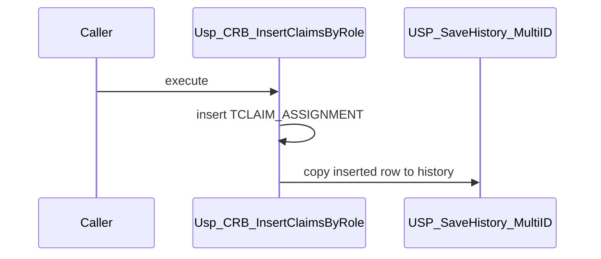
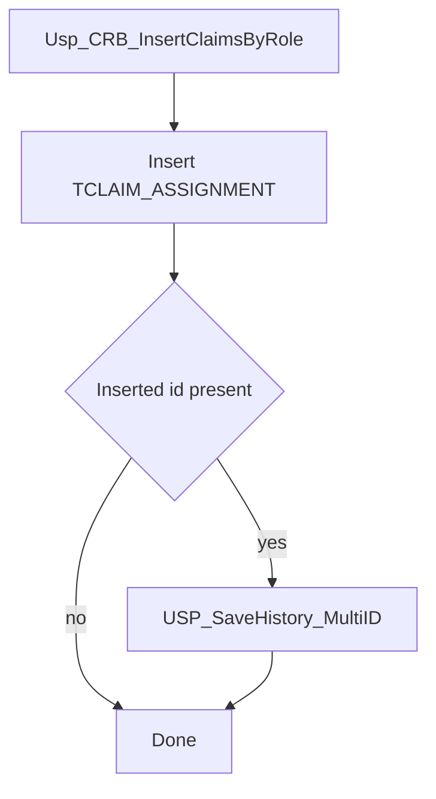

# Usp_CRB_InsertClaimsByRole

## What it does

Inserts one `TCLAIM_ASSIGNMENT` row for a claim, role or employee, and employer, then copies that row into `TCLAIM_ASSIGNMENT_History` through `USP_SaveHistory_MultiID`. Conference Room Booking Permission Setup calls it once per checked claim after delete.

## Parameters

| Name | Direction | What it is for |
|---|---|---|
| `@pClaimId` | in | Claim id to assign |
| `@pRoleID` | in | Role id for role-scoped grants. Optional |
| `@pEmployerId` | in | Employer for the assignment; also passed as history created-by |
| `@pSearchType` | in | Accepted by the procedure signature; the insert uses the role and employee values as passed |
| `@pEmployeeId` | in | Employee id for employee-scoped grants. Optional |

## Call sequence

## Callers

No other procedure or function calls this object. App callers: `employeeDAL.InsertClaimsBySearchType` from `employeeBLL.InsertClaimsBySearchType` on [Conference Room Booking Permission Setup](/docs/guides/admin-configuration/conference-room-booking-permission-setup).

## Nested

| Object | Kind | Page |
|---|---|---|
| `USP_SaveHistory_MultiID` | procedure | [USP_SaveHistory_MultiID](/docs/database/hrms/USP_SaveHistory_MultiID) |

## Steps

1. Script is `HRMS-DATABASE/HRMS-CRBBOOKING/STOREPROCEDURE/Usp_CRB_InsertClaimsByRole.sql`.
2. Insert into `TCLAIM_ASSIGNMENT` (`ClaimID`, `RoleId`, `Employerid`, `EmployeeId`) and capture `Claim_Assignm_ID`.
3. When an id was inserted, execute `USP_SaveHistory_MultiID` for `TCLAIM_ASSIGNMENT` → `TCLAIM_ASSIGNMENT_History` with action type `I`.

## Tables

| Table | Read or write |
|---|---|
| `TCLAIM_ASSIGNMENT` | write (insert) |
| `TCLAIM_ASSIGNMENT_History` | write (via nested history procedure) |

## Unresolved calls

None.

## Flow

