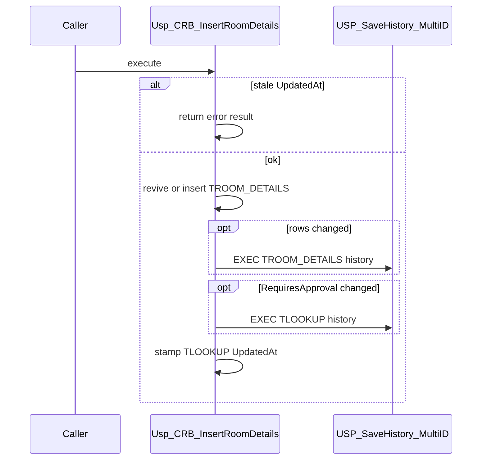
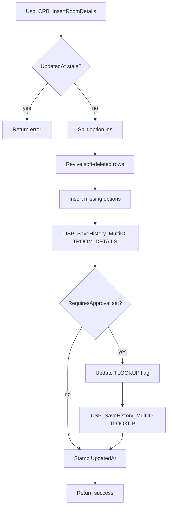

# Usp_CRB_InsertRoomDetails

## What it does

Inserts or revives soft-deleted amenity rows in `TROOM_DETAILS` for one employer/floor/room from a comma-separated option list, optionally updates the room’s `RequiresApproval` on `TLOOKUP`, stamps room `UpdatedAt`, and writes history via `USP_SaveHistory_MultiID`. Rejects the write when `@pUpdatedAt` is supplied and the room lookup is newer (concurrency).

## Parameters

| Name | Direction | What it is for |
|---|---|---|
| `@pEmployerid` | in | Employer scope; also history created-by |
| `@pFloorID` | in | Floor lookup id |
| `@pRoomID` | in | Room lookup id (parent 200) |
| `@pOptionID` | in | Comma-separated amenity option ids |
| `@pQuantity` | in | Seating capacity / quantity |
| `@pRequiresApproval` | in | Optional room approval flag |
| `@pUpdatedAt` | in | Optional concurrency token from prior get |

## Call sequence

## Callers

No other procedure or function in `HRMS-CRBBOOKING` calls this object. Application caller: CRB WebAPI `InsertMasterData` via `masterDataDAL.InsertMasterData`.

| Caller | Page |
|---|---|
| (application only) | No page yet |

## Nested

| Object | Kind | When | Page |
|---|---|---|---|
| `USP_SaveHistory_MultiID` | procedure (synonym to core) | After insert/revive of room-detail rows, and when room approval flag changes | [USP_SaveHistory_MultiID](/docs/database/hrms/USP_SaveHistory_MultiID) |

## Steps

1. Script is `HRMS-DATABASE/HRMS-CRBBOOKING/STOREPROCEDURE/Usp_CRB_InsertRoomDetails.sql`.
2. If `@pUpdatedAt` is set and room lookup `UpdatedAt` is newer, return failure and stop.
3. Split `@pOptionID` into distinct positive ints.
4. Revive matching soft-deleted `TROOM_DETAILS` rows; insert missing option rows.
5. When inserted or revived ids exist, `EXEC dbo.USP_SaveHistory_MultiID` for `TROOM_DETAILS` → `TROOM_DETAILS_History`.
6. Optionally update room `RequiresApproval` and history into `TLOOKUP_History`; always stamp room `UpdatedAt` to UTC now and return success counts.

## Tables

| Table | Read or write |
|---|---|
| `dbo.TROOM_DETAILS` | read and write |
| `dbo.TLOOKUP` | read and write |
| `dbo.TROOM_DETAILS_History` | write via nested `USP_SaveHistory_MultiID` |
| `dbo.TLOOKUP_History` | write via nested `USP_SaveHistory_MultiID` when approval changes |

## Unresolved calls

None.

## Flow

