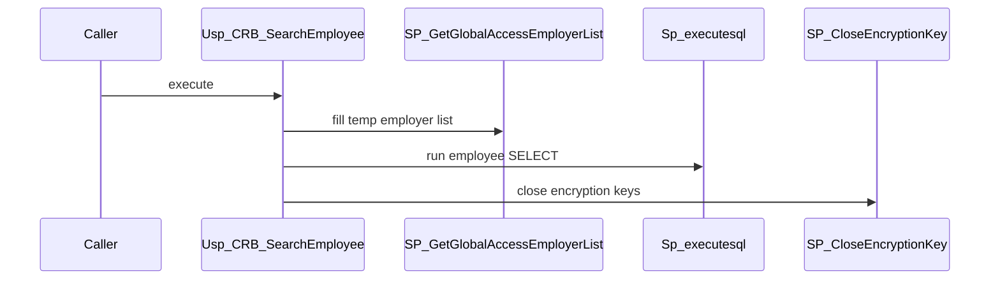
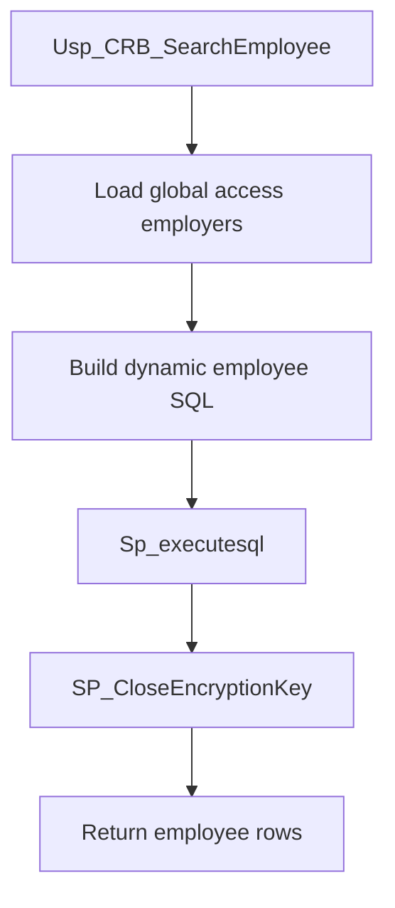

# Usp_CRB_SearchEmployee

## What it does

Builds and runs dynamic SQL that returns active employees for the selected employer, limited to the caller’s global-access employer list and location/BU scope. Conference Room Booking Permission Setup uses it to fill the Employee mode picker. Name, birth date, and manager names go through decrypt/name helpers.

## Parameters

| Name | Direction | What it is for |
|---|---|---|
| `@pEmployeeId` | in | Logged-in employee for employer list and location/BU scope. Also used when search type is `E` or `M` |
| `@pEmployerid` | in | Employer id filter embedded into the dynamic SQL |
| `@pEmployeeName` | in | Optional name fragment for `Fn_GetEmployeeName` like-match |
| `@pSearchType` | in | `A` all in scope, `E` one employee, `M` reports/functional reports. Empty becomes `A` |
| `@pCountryId` | in | Accepted; null becomes `-1`. Not applied in the built SELECT |

## Call sequence

## Callers

No other procedure or function calls this object. App callers: `employeeDAL.GetEmployeeDetails` → `employeeController.GetEmployeeDetails` from [Conference Room Booking Permission Setup](/docs/guides/admin-configuration/conference-room-booking-permission-setup).

## Nested

| Object | Kind | Page |
|---|---|---|
| `SP_GetGlobalAccessEmployerList` | procedure | [SP_GetGlobalAccessEmployerList](/docs/database/hrms/SP_GetGlobalAccessEmployerList) |
| `Fn_GetEmployeeName` | function | [Fn_GetEmployeeName](/docs/database/hrms/Fn_GetEmployeeName) |
| `Fn_DecryptData` | function | [Fn_DecryptData](/docs/database/hrms/Fn_DecryptData) |
| `FN_LocationBU_GetEmployeeDetails` | function | [FN_LocationBU_GetEmployeeDetails](/docs/database/hrms/FN_LocationBU_GetEmployeeDetails) |
| `SP_CloseEncryptionKey` | procedure | [SP_CloseEncryptionKey](/docs/database/hrms/SP_CloseEncryptionKey) |

`Sp_executesql` is a system procedure. `Sp_OpenEncryptionKeys` is commented out in the script.

## Steps

1. Script is `HRMS-DATABASE/HRMS-CRBBOOKING/STOREPROCEDURE/USp_CRB_SearchEmployee.sql`.
2. Load `#tmpEmployer` from `SP_GetGlobalAccessEmployerList @pEmployeeId` when the temp table does not already exist.
3. Build optional name and search-type filters into dynamic SQL over `TEmployee`, `TEmployeeInfo`, and `TORGChart`.
4. Execute the SQL with `Sp_executesql`, then call `SP_CloseEncryptionKey`.

## Tables

| Table | Read or write |
|---|---|
| `TEmployee` | read |
| `TEmployeeInfo` | read |
| `TORGChart` | read |
| `TOrgHierarchyDetails` | read |
| `TGender` | read |
| `TTitle` | read |
| `TGrade` | read |
| `#tmpEmployer` | write (temp) / read |

## Unresolved calls

None at one nested level beyond the helpers listed above.

## Flow

