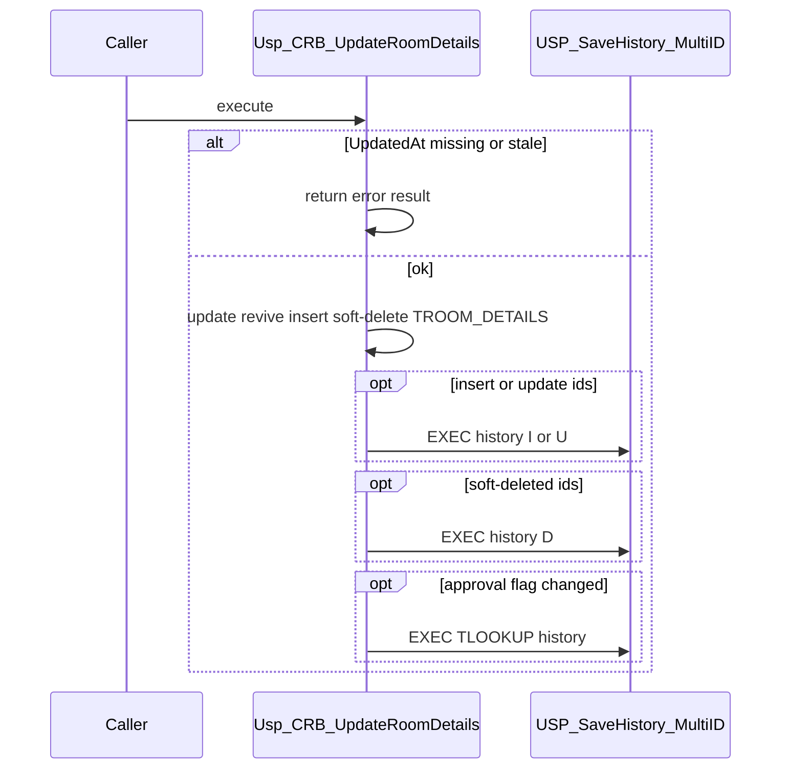
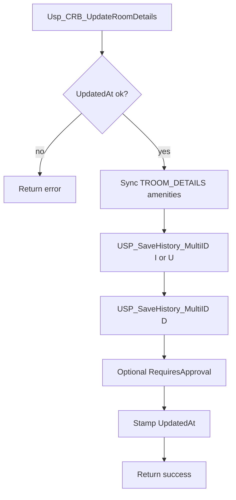

# Usp_CRB_UpdateRoomDetails

## What it does

Synchronises amenity rows for one floor/room against a comma-separated option list: updates quantities, revives soft-deleted matches, inserts missing options, soft-deletes options no longer selected, optionally updates room `RequiresApproval`, stamps room `UpdatedAt`, and writes history via `USP_SaveHistory_MultiID`. Requires `@pUpdatedAt` and rejects stale concurrency tokens.

## Parameters

| Name | Direction | What it is for |
|---|---|---|
| `@pRoomDetailsID` | in | Optional legacy id (not used in the body filters) |
| `@pEmployerid` | in | Employer scope; history created-by |
| `@pFloorID` | in | Floor lookup id |
| `@pRoomID` | in | Room lookup id |
| `@pOptionID` | in | Comma-separated amenity option ids |
| `@pQuantity` | in | Seating capacity / quantity |
| `@pRequiresApproval` | in | Optional room approval flag |
| `@pUpdatedAt` | in | Required concurrency token from prior get |

## Call sequence

## Callers

No other procedure or function in `HRMS-CRBBOOKING` calls this object. Application caller: CRB WebAPI `UpdateMasterData` via `masterDataDAL.UpdateMasterData`.

| Caller | Page |
|---|---|
| (application only) | No page yet |

## Nested

| Object | Kind | When | Page |
|---|---|---|---|
| `USP_SaveHistory_MultiID` | procedure (synonym to core) | After insert/update and soft-delete of room-detail rows, and when room approval flag changes | [USP_SaveHistory_MultiID](/docs/database/hrms/USP_SaveHistory_MultiID) |

## Steps

1. Script is `HRMS-DATABASE/HRMS-CRBBOOKING/STOREPROCEDURE/Usp_CRB_UpdateRoomDetails.sql`.
2. If `@pUpdatedAt` is null, or room lookup `UpdatedAt` is newer, return failure and stop.
3. Split `@pOptionID`; update active quantities; revive selected soft-deleted rows; insert missing options; soft-delete active options not in the selected set.
4. `EXEC dbo.USP_SaveHistory_MultiID` for insert/update ids, then again for soft-deleted ids (`ActionType` `D`).
5. Optionally update room `RequiresApproval`; stamp `UpdatedAt`; history `TLOOKUP` when the flag changed; return success counts.

## Tables

| Table | Read or write |
|---|---|
| `dbo.TROOM_DETAILS` | read and write |
| `dbo.TLOOKUP` | read and write |
| `dbo.TROOM_DETAILS_History` | write via nested `USP_SaveHistory_MultiID` |
| `dbo.TLOOKUP_History` | write via nested `USP_SaveHistory_MultiID` when approval changes |

## Unresolved calls

None.

## Flow

