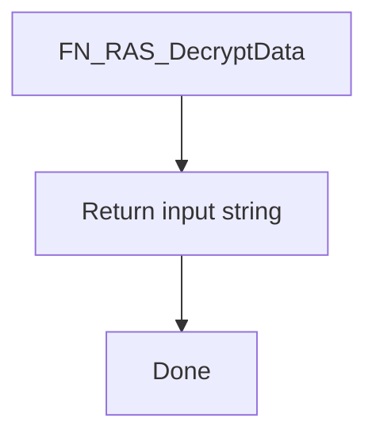

# FN_RAS_DecryptData

## What it does

Scalar function intended to decrypt Resource Allocation rate (or other) ciphertext. The inventoried body returns `@String` unchanged (pass-through stub). Called from `Sp_RA_GetResourceReports` for `RateAmount` / `RateAmountText`.

## Parameters

| Name | Direction | What it is for |
|---|---|---|
| `@String` | in | Value to decrypt; returned as-is in current script |

Returns `varchar(100)`.

## Call sequence

Calls no other procedures or functions.

## Callers

`Sp_RA_GetResourceReports` (and any other RA scripts that reference the function). Application path: [Reports](/docs/guides/resource-allocation/reports) search → `Sp_RA_GetResourceReports`.

## Nested

Calls no other procedures or functions.

## Steps

1. Script is `HRMS-DATABASE/HRMS-RESOURCEALLOCATION/FUNCTIONS/FN_RAS_DecryptData.sql`.
2. `RETURN @String`.

## Tables

None.

## Unresolved calls

None. A sibling script `FN_RAS_DecryptData_New.sql` exists in the same folder; this page documents the primary `FN_RAS_DecryptData.sql` inventory object only.

## Flow

