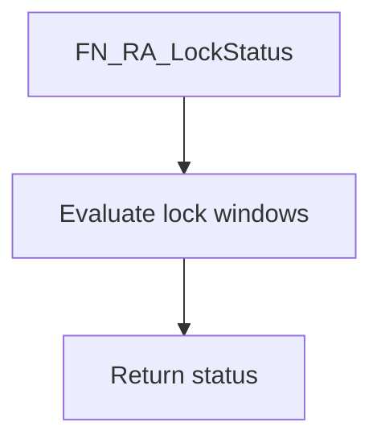

# FN_RA_LockStatus

## What it does

Scalar helper returning lock status text/flag for one resource allocation (used by `USP_RA_GetResourcesList`).

## Parameters

| Name | Direction | What it is for |
|---|---|---|
| `@ResourceAllocationID` | in | Allocation id |
| `@Project_CD` | in | Project id |
| `@Allocation_EndDate` | in | Allocation end date |

## Call sequence

May read lock-matrix / unlock-request tables (see function body). No EXEC of procedures.

## Callers

Nested from `USP_RA_GetResourcesList` used by [Manage Allocation](/docs/guides/resource-allocation/manage-allocation).

## Nested

None (function).

## Steps

1. Script is `FUNCTIONS/FN_RA_LockStatus.sql`.
2. Evaluate lock windows for the allocation/project and return status.

## Tables

| Table | Read or write |
|---|---|
| `dbo.TRAS_LOCK_MATRIX` | read |
| `dbo.TRAS_UNLOCK_REQUEST` | read |

## Unresolved calls

None.

## Flow

