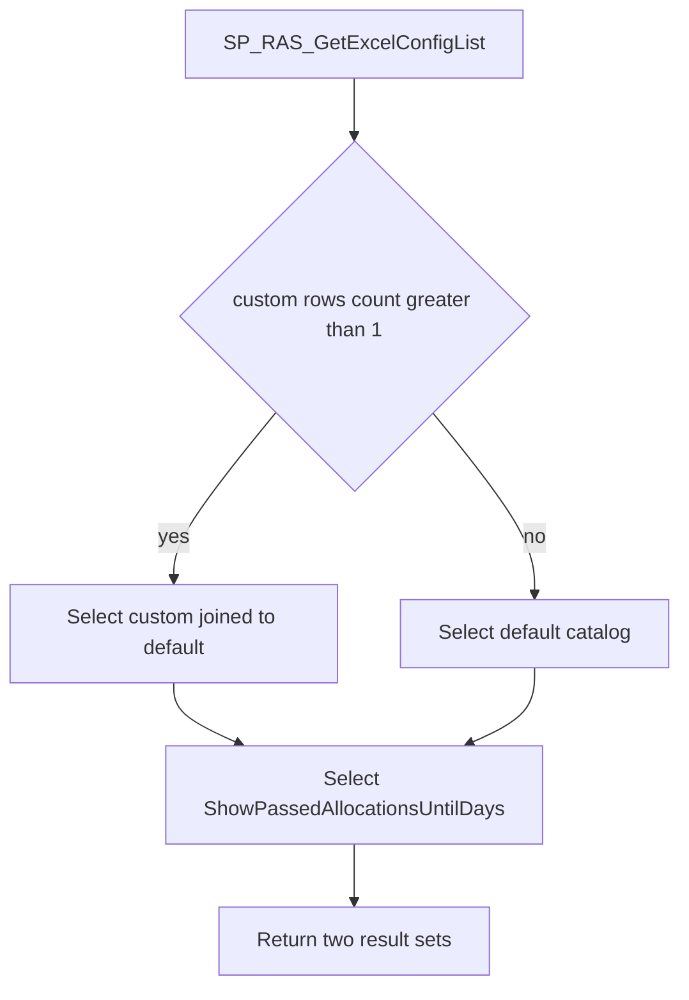

# SP_RAS_GetExcelConfigList

## What it does

Returns RAS Excel field configuration for one employer as two result sets: field rows, then `ShowPassedAllocationsUntilDays`. If the employer already has more than one custom row in `tref_ras_excelConfig_custom`, those custom rows are returned; otherwise the default `tref_ras_excelConfig` catalog is returned. Used by RA Permission Setup → RAS Setup Config.

## Parameters

| Name | Direction | What it is for |
|---|---|---|
| `@EmployerId` | in | Employer whose custom config is checked |

## Call sequence

Calls no other procedures or functions.

## Callers

No other procedure or function in `HRMS-RESOURCEALLOCATION` calls this object. Application caller: `raProviderDAL.GetExcelConfigList` → `raProviderController.GetExcelConfigList` from [RA Permission Setup](/docs/guides/admin-configuration/ra-permission-setup).

## Nested

Calls no other procedures or functions.

## Steps

1. Script is `HRMS-DATABASE/HRMS-RESOURCEALLOCATION/STOREPROCEDURE/SP_RAS_GetExcelConfigList.sql`.
2. If `tref_ras_excelConfig_custom` has more than one row for `@EmployerId`, select those custom rows joined to `tref_ras_excelConfig`, ordered by id; then select `ShowPassedAllocationsUntilDays` from synonym `TCustomerSettings`.
3. Else select all default `tref_ras_excelConfig` rows, then `ShowPassedAllocationsUntilDays` from `TCustomerSettings` (second branch also has an `ORDER BY ID` on the settings select).

## Tables

| Table | Read or write |
|---|---|
| `tref_ras_excelConfig_custom` | read |
| `tref_ras_excelConfig` | read |
| `dbo.TCustomerSettings` | read (synonym to HRMS) |

## Unresolved calls

None.

## Flow

