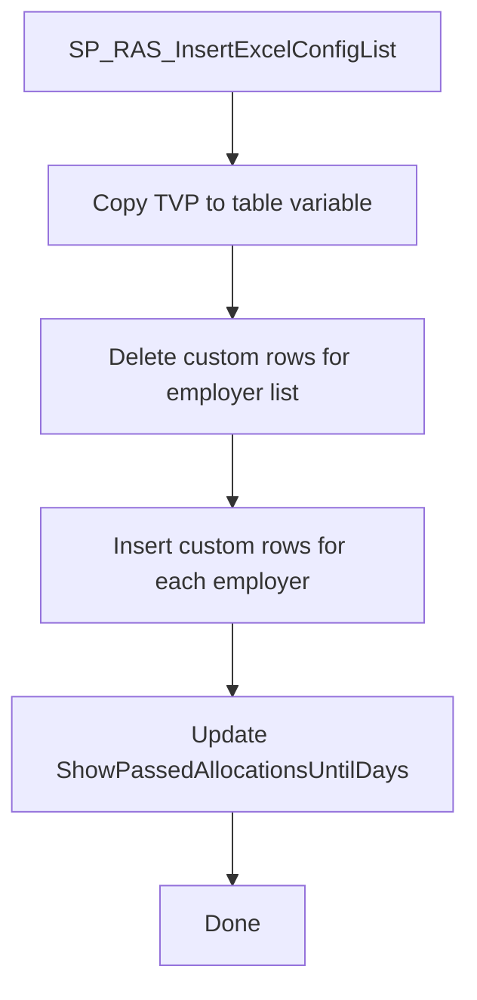

# SP_RAS_InsertExcelConfigList

## What it does

Replaces custom RAS Excel mandatory flags for one or more employers listed in a comma-separated `@EmployerId` string, then updates `ShowPassedAllocationsUntilDays` on synonym `TCustomerSettings` for those employers. Used by RA Permission Setup → RAS Setup Config save.

## Parameters

| Name | Direction | What it is for |
|---|---|---|
| `@EmployerId` | in | Comma-separated employer ids |
| `@EmployeeId` | in | Acting employee stored as `CreatedBy` |
| `@ConfigList` | in | Table-valued `UDT_TRASExcelConfigList` (`ReferenceId`, `IsMandatory`) |
| `@ShowPassedAllocationsUntilDays` | in | Days value written to `TCustomerSettings` |

## Call sequence

Calls no other procedures or functions. Uses `string_split` on `@EmployerId`.

## Callers

No other procedure or function in `HRMS-RESOURCEALLOCATION` calls this object. Application caller: `raProviderDAL.InsertExcelConfigList` → `raProviderController.InsertExcelConfigList` from [RA Permission Setup](/docs/guides/admin-configuration/ra-permission-setup).

## Nested

Calls no other procedures or functions.

## Steps

1. Script is `HRMS-DATABASE/HRMS-RESOURCEALLOCATION/STOREPROCEDURE/SP_RAS_InsertExcelConfigList.sql`.
2. Copy `@ConfigList` into a table variable.
3. Delete existing `tref_ras_excelConfig_custom` rows for every employer id in `string_split(@EmployerId, ',')`.
4. Insert new custom rows as the cross product of config references and employer ids, with `CreatedBy = @EmployeeId`.
5. Update `TCustomerSettings.ShowPassedAllocationsUntilDays` for those employer ids.

## Tables

| Table | Read or write |
|---|---|
| `tref_ras_excelConfig_custom` | write (delete then insert) |
| `dbo.TCustomerSettings` | write (update via synonym) |
| `UDT_TRASExcelConfigList` | read (TVP input) |

## Unresolved calls

None. Node DAL currently binds `@EmployeeId` from `request.employerId` rather than `request.employeeId`.

## Flow

