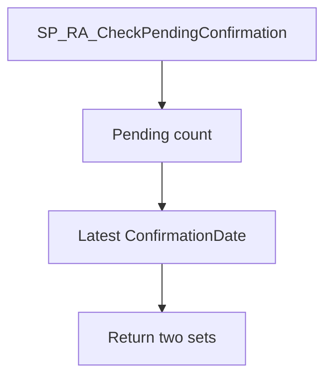

# SP_RA_CheckPendingConfirmation

## What it does

Returns two result sets: pending homepage notification count for `RPI_PendingRAPublish`, and the latest `ConfirmationDate` for the employee/employer.

## Parameters

| Name | Direction | What it is for |
|---|---|---|
| `@pEmployeeId` | in | Employee |
| `@pEmployerId` | in | Employer |

## Call sequence

Calls no other procedures or functions.

## Callers

Application caller: `raDAL.CheckConfirmationPending` from [Manage Allocation](/docs/guides/resource-allocation/manage-allocation).

## Nested

Calls no other procedures or functions.

## Steps

1. Read pending count from homepage notification synonyms for `RPI_PendingRAPublish`.
2. Return latest `TRESOURCEALLOCATION_CONFIRMATION.ConfirmationDate`.

## Tables

| Table | Read or write |
|---|---|
| `dbo.THomePageNotifications / THomePageNotificationCnts / THrmsModules` | read (synonym) |
| `dbo.TRESOURCEALLOCATION_CONFIRMATION` | read |

## Unresolved calls

None.

## Flow

