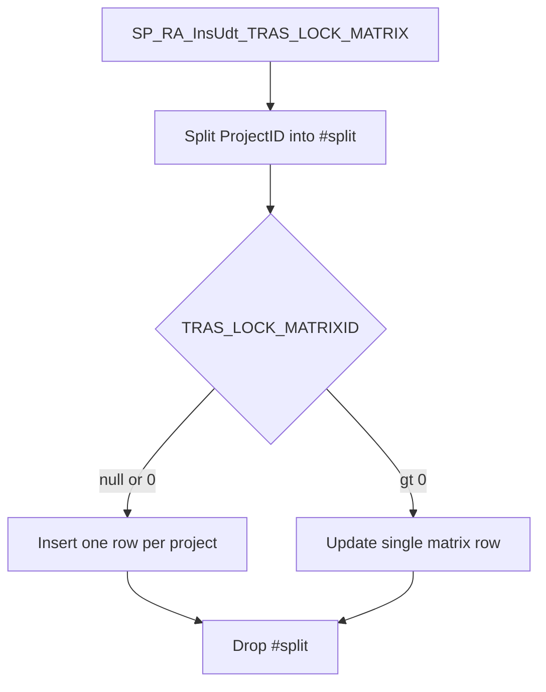

# SP_RA_InsUdt_TRAS_LOCK_MATRIX

## What it does

Inserts or updates Resource Allocation lock-policy rows in `TRAS_LOCK_MATRIX`. When `@TRAS_LOCK_MATRIXID` is null/0, splits `@ProjectID` on commas and inserts one row per project id (same client/frequency/lock settings). When an id is supplied, updates that single row. Sets `FreezeDate` from `@FrequencyEffectiveDate`. Used by Resource Allocation → Lock Policy save.

## Parameters

| Name | Direction | What it is for |
|---|---|---|
| `@TRAS_LOCK_MATRIXID` | in | Null/0 = insert; greater than 0 = update that id |
| `@EmployerID` | in | Employer for the matrix row |
| `@ClientID` | in | Client for the matrix row |
| `@ProjectID` | in | Comma-separated project ids on insert; single value stored on update. Required in inventory script; V1 DAL does not bind it |
| `@InvoicingFrequency` | in | Lookup id (parent 19000) as varchar |
| `@FrequencyEffectiveDate` | in | Effective / freeze date |
| `@LockAfterDays` | in | Days after frequency before lock |
| `@AlertManagerBeforeDays` | in | Days before lock to alert manager |
| `@UnlockTimeSpanHours` | in | Unlock window in hours |
| `@IsActive` | in | Active flag |
| `@LoginUserID` | in | CreatedBy on insert; EditedBy on update |

## Call sequence

Calls no other procedures or functions.

## Callers

No other procedure or function in `HRMS-RESOURCEALLOCATION` calls this object. Application caller: RA WebAPI `raDAL.InsertUpdateLockMatrix` → `raController.InsertUpdateLockMatrix` from [Lock Policy](/docs/guides/resource-allocation/lock-policy).

## Nested

Calls no other procedures or functions.

## Steps

1. Script is `HRMS-DATABASE/HRMS-RESOURCEALLOCATION/STOREPROCEDURE/SP_RA_InsUdt_TRAS_LOCK_MATRIX.sql`.
2. Populate `#split` from `STRING_SPLIT` of `@ProjectID`.
3. If `@TRAS_LOCK_MATRIXID` is null/0: `INSERT` into `TRAS_LOCK_MATRIX` selecting from `#split` with audit `CreatedBy` / `CreatedOn` and `FreezeDate = @FrequencyEffectiveDate`.
4. If `@TRAS_LOCK_MATRIXID` > 0: `UPDATE` that row including `EditedBy` / `EditedOn` and `FreezeDate`.
5. Drop `#split`.

## Tables

| Table | Read or write |
|---|---|
| `dbo.TRAS_LOCK_MATRIX` | write |

## Unresolved calls

None.

## Flow

