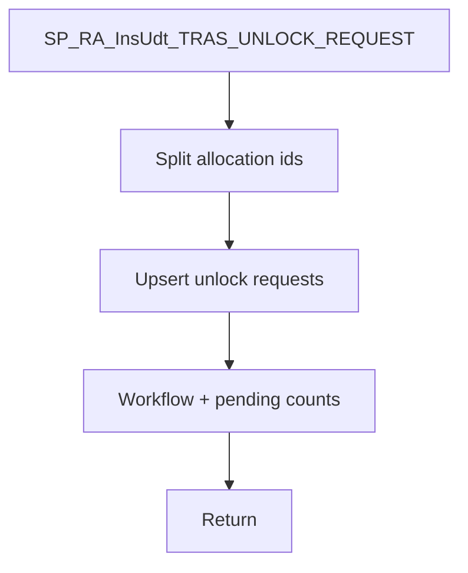

# SP_RA_InsUdt_TRAS_UNLOCK_REQUEST

## What it does

Creates or updates freeze/unfreeze unlock requests for one or more resource allocation ids, wires workflow for `RA-FreezeUnFreeze`, and adjusts pending notification counts.

## Parameters

| Name | Direction | What it is for |
|---|---|---|
| `@TRAS_UNLOCK_REQUEST_ID` | in | Existing request id or null |
| `@ResourceAllocationID` | in | Comma-separated allocation ids |
| `@EmployeeID` | in | Subject employee |
| `@EmployerID` | in | Employer |
| `@UnlockStartDate / @UnlockEndDate` | in | Unlock window |
| `@Status` | in | Request status |
| `@Reason` | in | Reason text |
| `@IsActive` | in | Active flag |
| `@LoginUserID` | in | Actor |

## Call sequence

`SP_CM_GetWorkflowTreeXmlDetailsByPageTitle`, then `Sp_RA_InsertPendingCount` / `Sp_RA_UpdatePendingCount` depending on path.

## Callers

Application caller: `raDAL` InsertUpdateLockRequest from [Manage Allocation](/docs/guides/resource-allocation/manage-allocation) Unfreeze dialog.

## Nested

`SP_CM_GetWorkflowTreeXmlDetailsByPageTitle` (HRMS), `Sp_RA_InsertPendingCount`, `Sp_RA_UpdatePendingCount`.

## Steps

1. Split allocation ids into temp table.
2. Insert/update `TRAS_UNLOCK_REQUEST` rows.
3. Load freeze/unfreeze workflow and insert pending counts for approvers.

## Tables

| Table | Read or write |
|---|---|
| `dbo.TRAS_UNLOCK_REQUEST` | write |
| `dbo.TRESOURCEALLOCATION` | read |

## Unresolved calls

None.

## Flow

