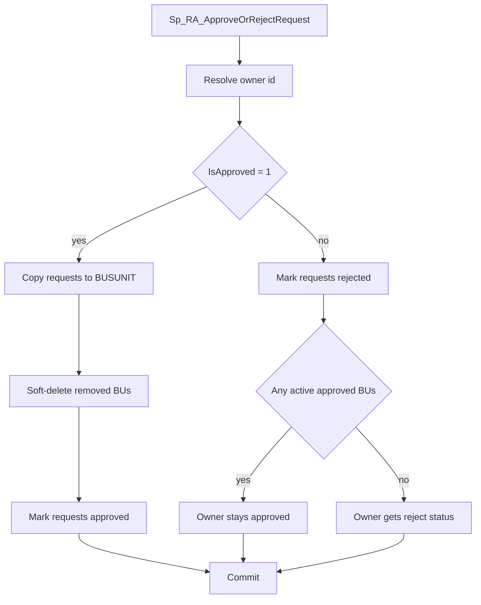

# Sp_RA_ApproveOrRejectRequest

## What it does

Approves or rejects pending RAS Provider BU requests for one owner. On approve (`@pIsApproved = 1`) it copies pending request BUs into `TRESOURCE_ALLOC_OWNER_BUSUNIT`, soft-deletes approved BUs that are no longer requested, and marks request rows approved. On reject it marks pending request rows with the reject status and keeps the owner approved if any active approved BUs remain.

## Parameters

| Name | Direction | What it is for |
|---|---|---|
| `@pEmployeeID` | in | Owner employee id |
| `@pEmployerid` | in | Owner employer id |
| `@pIsApproved` | in | `1` approve, otherwise reject path |
| `@pEditedBy` | in | Approver employee id |
| `@pResAllocOwnerID` | out | Resolved owner id |

## Call sequence

Calls no other procedures or functions.

## Callers

No other procedure or function in `HRMS-RESOURCEALLOCATION` calls this object. Application caller: RA WebAPI `raProviderDAL.ApproveRejectRASProviderRequest` from [Manage Access](/docs/guides/resource-allocation/manage-access).

## Nested

Calls no other procedures or functions.

## Steps

1. Script is `HRMS-DATABASE/HRMS-RESOURCEALLOCATION/STOREPROCEDURE/Sp_RA_ApproveOrRejectRequest.sql`.
2. Begin transaction; resolve `@pResAllocOwnerID` from `TRESOURCE_ALLOCATION_OWNER`.
3. If `@pIsApproved = 1`: update owner to approved; insert missing pending BUs into `TRESOURCE_ALLOC_OWNER_BUSUNIT`; soft-delete BUs not in the pending set; mark pending request rows approved.
4. Else: mark pending request rows with `@pIsApproved`; if any non-deleted approved BUs remain, force owner `IsApproved = 1`; otherwise update owner with the reject value.
5. Commit or roll back with `RAISERROR`.

## Tables

| Table | Read or write |
|---|---|
| `dbo.TRESOURCE_ALLOCATION_OWNER` | read / write |
| `dbo.TRESOURCE_ALLOC_OWNER_BUSUNIT` | read / write |
| `dbo.TRESOURCE_ALLOC_OWNER_BUSUNIT_REQUEST` | read / write |

## Unresolved calls

None.

## Flow

