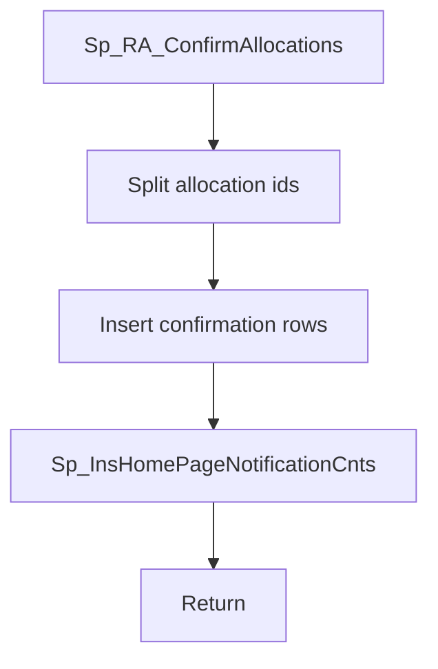

# Sp_RA_ConfirmAllocations

## What it does

Confirms a comma-separated list of resource allocation ids for the logged-in owner: inserts `TRESOURCEALLOCATION_CONFIRMATION` rows and adjusts homepage pending notification counts via `Sp_InsHomePageNotificationCnts`.

## Parameters

| Name | Direction | What it is for |
|---|---|---|
| `@pEmployeeId` | in | Confirming employee (owner) |
| `@pEmployerId` | in | Employer |
| `@pResourceAllocationIds` | in | Comma-separated allocation ids |

## Call sequence

Splits ids, inserts confirmation rows per id, then `EXEC Sp_InsHomePageNotificationCnts`.

## Callers

Application caller: `raDAL.ConfirmResourceAllocations` from [Manage Allocation](/docs/guides/resource-allocation/manage-allocation).

## Nested

`Sp_InsHomePageNotificationCnts` (HRMS synonym). Uses `dbo.Split`.

## Steps

1. Cursor over split `@pResourceAllocationIds`.
2. Resolve `ResourceAllocationOwnerID` for the employee.
3. Insert confirmation rows; aggregate BU confirmation counts.
4. Call `Sp_InsHomePageNotificationCnts` to clear/adjust pending publish counts.

## Tables

| Table | Read or write |
|---|---|
| `dbo.TRESOURCEALLOCATION_CONFIRMATION` | write |
| `dbo.TRESOURCE_ALLOCATION_OWNER` | read |
| `dbo.TRESOURCE_ALLOC_OWNER_BUSUNIT` | read |
| `dbo.TOrgHierarchyDetails` | read (synonym) |

## Unresolved calls

None.

## Flow

