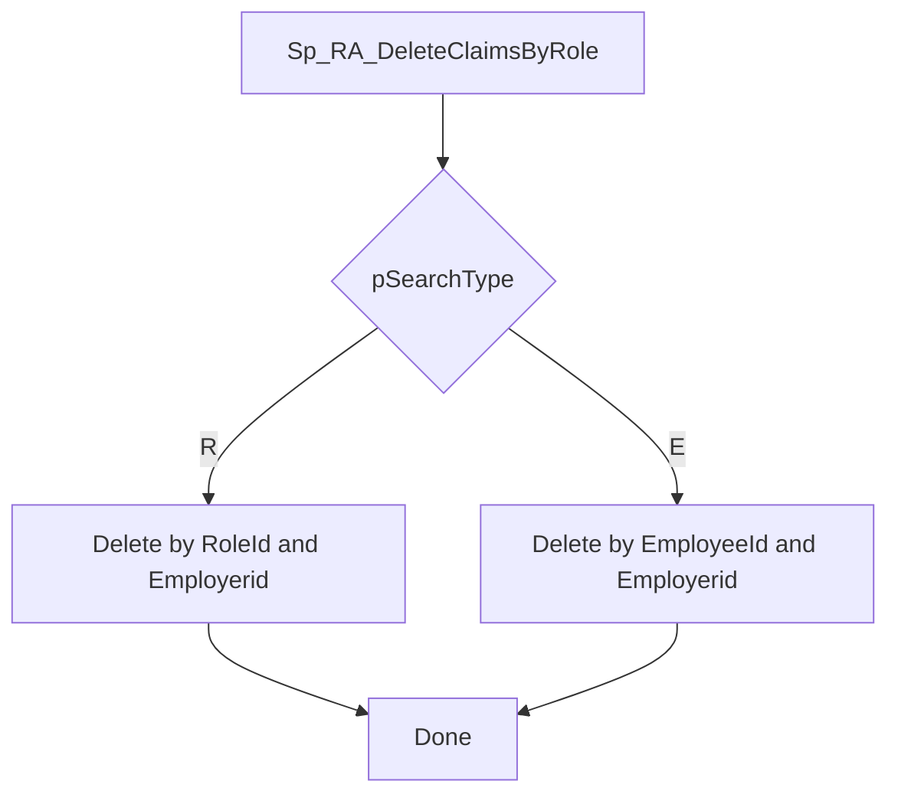

# Sp_RA_DeleteClaimsByRole

## What it does

Deletes all `TCLAIM_ASSIGNMENT` rows for one employer scoped either to a role (`@pSearchType = 'R'`) or to an employee (`E`). RA Permission Setup always runs this before re-inserting checked claims inside one API transaction.

## Parameters

| Name | Direction | What it is for |
|---|---|---|
| `@pRoleID` | in | Role id when deleting role assignments. Default null |
| `@pEmployerId` | in | Employer scope |
| `@pSearchType` | in | `R` delete by role, `E` delete by employee |
| `@pEmployeeId` | in | Employee id when `@pSearchType` is `E`. Default null |

## Call sequence

Calls no other procedures or functions.

## Callers

No other procedure or function in `HRMS-RESOURCEALLOCATION` calls this object. Application caller: `EmployeeDAL.DeleteClaimsBySearchType` → `employeeBLL.InsertClaimsBySearchType` from [RA Permission Setup](/docs/guides/admin-configuration/ra-permission-setup).

## Nested

Calls no other procedures or functions.

## Steps

1. Script is `HRMS-DATABASE/HRMS-RESOURCEALLOCATION/STOREPROCEDURE/Sp_RA_DeleteClaimsByRole.sql`.
2. Delete from `TCLAIM_ASSIGNMENT` where `Employerid = @pEmployerId` and either `RoleId = @pRoleID` (`R`) or `EmployeeId = @pEmployeeId` (`E`).

## Tables

| Table | Read or write |
|---|---|
| `TCLAIM_ASSIGNMENT` | write (delete) |

## Unresolved calls

None.

## Flow

