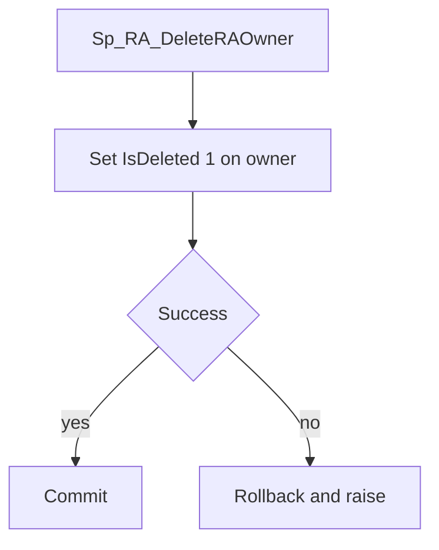

# Sp_RA_DeleteRAOwner

## What it does

Soft-deletes a RAS Provider by setting `TRESOURCE_ALLOCATION_OWNER.IsDeleted = 1` for the employee and employer, with edit audit fields, inside a transaction.

## Parameters

| Name | Direction | What it is for |
|---|---|---|
| `@pEmployeeID` | in | Owner employee id |
| `@pEmployerId` | in | Owner employer id |
| `@pEditedBy` | in | Employee performing the delete |

## Call sequence

Calls no other procedures or functions.

## Callers

No other procedure or function in `HRMS-RESOURCEALLOCATION` calls this object. Application caller: RA WebAPI `raProviderDAL.DeleteResourceAllocationOwner` from [Manage Access](/docs/guides/resource-allocation/manage-access).

## Nested

Calls no other procedures or functions.

## Steps

1. Script is `HRMS-DATABASE/HRMS-RESOURCEALLOCATION/STOREPROCEDURE/Sp_RA_DeleteRAOwner.sql`.
2. Begin transaction; update matching owner row to `IsDeleted = 1` with `@pEditedBy` / `GETDATE()`.
3. On error, roll back and `RAISERROR`; otherwise commit.

## Tables

| Table | Read or write |
|---|---|
| `dbo.TRESOURCE_ALLOCATION_OWNER` | write |

## Unresolved calls

None.

## Flow

