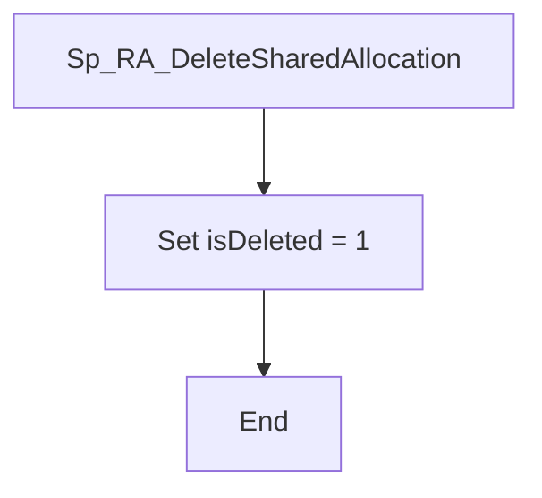

# Sp_RA_DeleteSharedAllocation

## What it does

Soft-deletes one additional-owner share row by setting `isDeleted = 1` on `TRESOURCE_ALLOC_ADDL_OWNER` for the given allocation id and employer.

## Parameters

| Name | Direction | What it is for |
|---|---|---|
| `@pAllocationId` | in | `ResourceAllocAddlOwnerID` to soft-delete |
| `@pEmployerid` | in | Employer scope for the update |

## Call sequence

Calls no other procedures or functions.

## Callers

No other procedure or function in HRMS-RESOURCEALLOCATION calls this object. Application callers: Node `raProviderDAL_V3.DeleteSharedAllocation` (UI constant exists; no React caller found under Resource Allocation).

## Nested

Calls no other procedures or functions.

## Steps

1. Update `TRESOURCE_ALLOC_ADDL_OWNER` set `isDeleted = 1` where `ResourceAllocAddlOwnerID = @pAllocationId` and `Employerid = @pEmployerid` (`Sp_RA_DeleteSharedAllocation.sql`).

## Tables

| Table | Read or write |
|---|---|
| `TRESOURCE_ALLOC_ADDL_OWNER` | write |

## Flow

