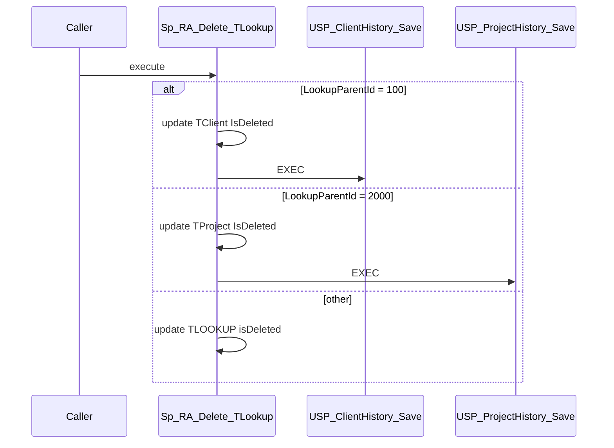
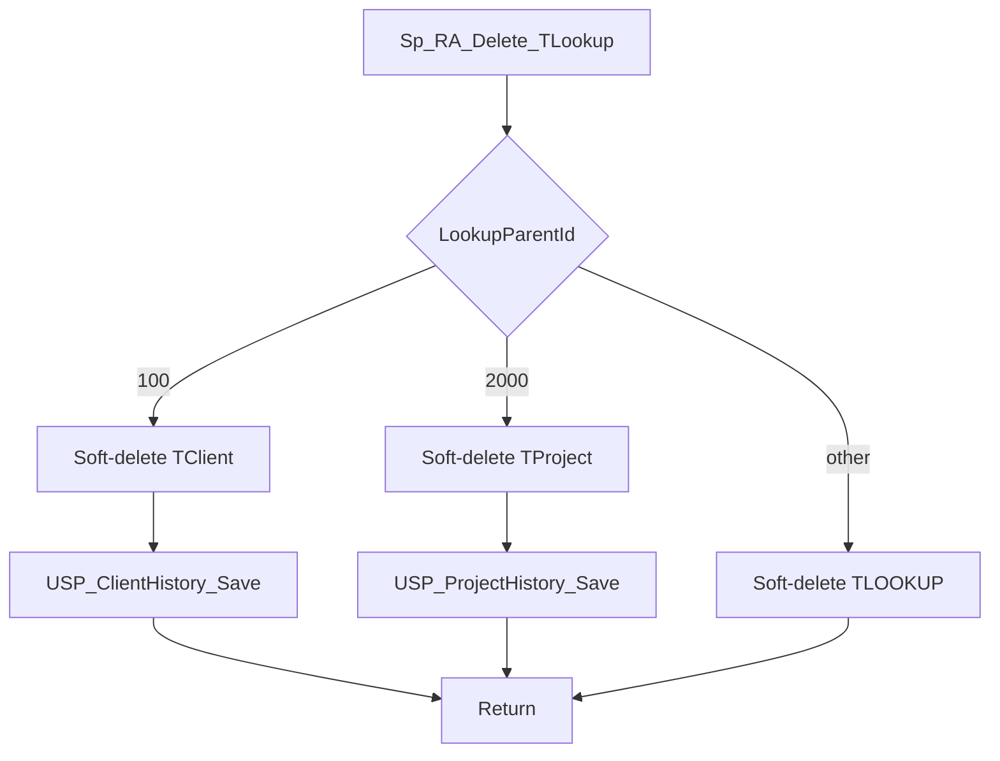

# Sp_RA_Delete_TLookup

## What it does

Soft-deletes a Resource Allocation reference row. Clients (`@LookupParentId = 100`) and projects (`2000`) are flagged `IsDeleted` on `TClient` / `TProject` and copied to history. Other parents set `TLOOKUP.isDeleted = 1` for the employer.

## Parameters

| Name | Direction | What it is for |
|---|---|---|
| `@LookupID` | in | Row to soft-delete |
| `@pEmployerid` | in | Employer scope for `TLOOKUP` deletes |
| `@LookupParentId` | in | Parent type; drives client/project vs lookup branch |
| `@CreatedBy` | in | Actor stamped on client/project update |

## Call sequence

## Callers

No other procedure or function in `HRMS-RESOURCEALLOCATION` calls this object. Application caller: RA WebAPI `DeleteLookupItem`.

## Nested

| Object | Kind | When | Page |
|---|---|---|---|
| `USP_ClientHistory_Save` | procedure | after soft-delete of client | [USP_ClientHistory_Save](/docs/database/hrms/USP_ClientHistory_Save) |
| `USP_ProjectHistory_Save` | procedure | after soft-delete of project | [USP_ProjectHistory_Save](/docs/database/hrms/USP_ProjectHistory_Save) |

## Steps

1. Script is `HRMS-DATABASE/HRMS-RESOURCEALLOCATION/STOREPROCEDURE/Sp_RA_Delete_TLookup.sql`.
2. If `@LookupParentId = 100`, set `TClient.IsDeleted = 1` for `@LookupID`, then `EXEC USP_ClientHistory_Save`.
3. Else if `@LookupParentId = 2000`, set `TProject.IsDeleted = 1` for `@LookupID`, then `EXEC USP_ProjectHistory_Save`.
4. Else update `TLOOKUP` set `isDeleted = 1` where `Lookup_Id` and `Employerid` match.

## Tables

| Table | Read or write |
|---|---|
| `dbo.TClient` | write (via synonym) |
| `dbo.TProject` | write (via synonym) |
| `dbo.TLOOKUP` | write (via synonym) |
| `dbo.TClientHistory` | write via nested history save |
| `dbo.TProjectHistory` | write via nested history save |

## Flow

