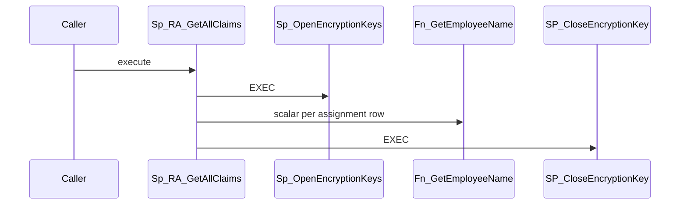
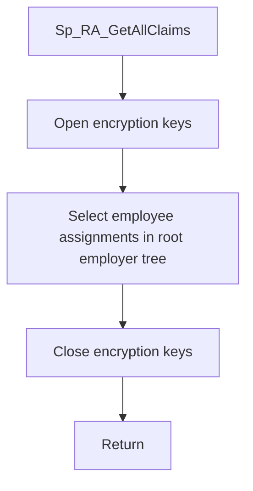

# Sp_RA_GetAllClaims

## What it does

Returns employee-scoped claim assignments for every employer under the same root employer as `@pEmployerId`. Used by RA Permission Setup → View Permission. Opens encryption keys so `Fn_GetEmployeeName` can decrypt names.

## Parameters

| Name | Direction | What it is for |
|---|---|---|
| `@pEmployerId` | in | Employer used to resolve `RootEmployerId` for the org tree |

## Call sequence

## Callers

No other procedure or function in `HRMS-RESOURCEALLOCATION` calls this object. Application caller: `EmployeeDAL.GetAllClaims` → `employeeController.GetAllClaims` from [RA Permission Setup](/docs/guides/admin-configuration/ra-permission-setup).

## Nested

| Object | Kind | When | Page |
|---|---|---|---|
| `Sp_OpenEncryptionKeys` | procedure | start of body | [Sp_OpenEncryptionKeys](/docs/database/hrms/Sp_OpenEncryptionKeys) |
| `Fn_GetEmployeeName` | function | each selected assignment | [Fn_GetEmployeeName](/docs/database/hrms/Fn_GetEmployeeName) |
| `SP_CloseEncryptionKey` | procedure | end of body | [SP_CloseEncryptionKey](/docs/database/hrms/SP_CloseEncryptionKey) |

## Steps

1. Script is `HRMS-DATABASE/HRMS-RESOURCEALLOCATION/STOREPROCEDURE/Sp_RA_GetAllClaims.sql`.
2. `EXEC dbo.Sp_OpenEncryptionKeys`.
3. Select employment number, decrypted employee name, role name (via `TUsers` / `TRoles`), claim text, and module id from `TCLAIM_ASSIGNMENT` joined to `TCLAIM` where `EmployeeId > 0` and employer is in the root-employer tree of `@pEmployerId`.
4. Order by employee and claim.
5. `EXEC dbo.SP_CloseEncryptionKey`.

## Tables

| Table | Read or write |
|---|---|
| `TCLAIM_ASSIGNMENT` | read |
| `TCLAIM` | read |
| `dbo.TEmployeeInfo` | read (synonym) |
| `dbo.TUsers` | read (synonym) |
| `dbo.TRoles` | read (synonym) |
| `dbo.TEmployerDetails` | read (synonym) |

## Unresolved calls

None at one nested level.

## Flow

