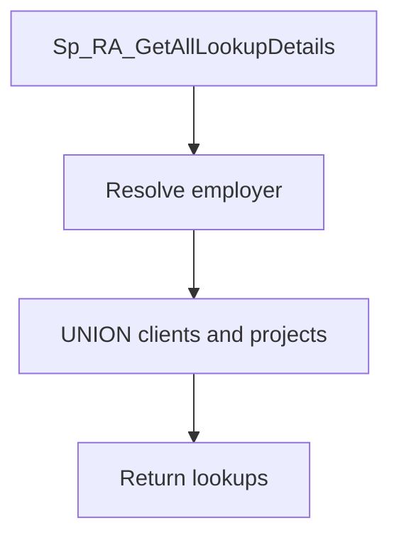

# Sp_RA_GetAllLookupDetails

## What it does

Returns client and project lookup rows (plus related lookup parents) for the employee's employer, used to populate RAS allocation dropdowns.

## Parameters

| Name | Direction | What it is for |
|---|---|---|
| `@pEmployeeId` | in | Employee whose employer drives the list |

## Call sequence

Calls no other procedures. Sample comment references `Sp_RA_GetAllLookupDetails_DP` but this body does not EXEC it.

## Callers

Application caller: `raDAL.GetAllLookupDetailsRAS` from [Manage Allocation](/docs/guides/resource-allocation/manage-allocation).

## Nested

None in the live body.

## Steps

1. Resolve employer from `TEmployeeInfo`.
2. UNION client rows from `TClient` with project rows from `TProject` / `TClientProjectMapping` and lookup parents from `TLOOKUP`.

## Tables

| Table | Read or write |
|---|---|
| `dbo.TEmployeeInfo` | read (synonym) |
| `dbo.TClient` | read |
| `dbo.TProject` | read |
| `dbo.TClientProjectMapping` | read |
| `dbo.TLOOKUP` | read |

## Unresolved calls

None.

## Flow

