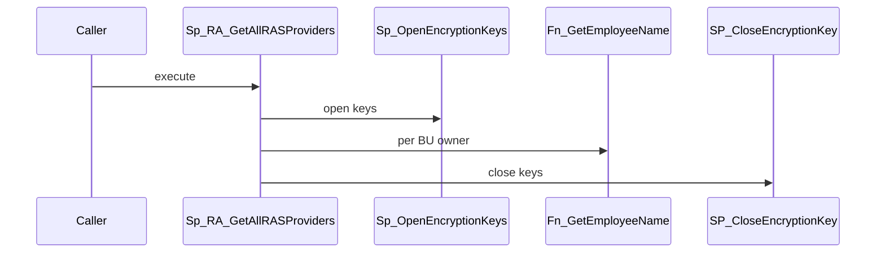
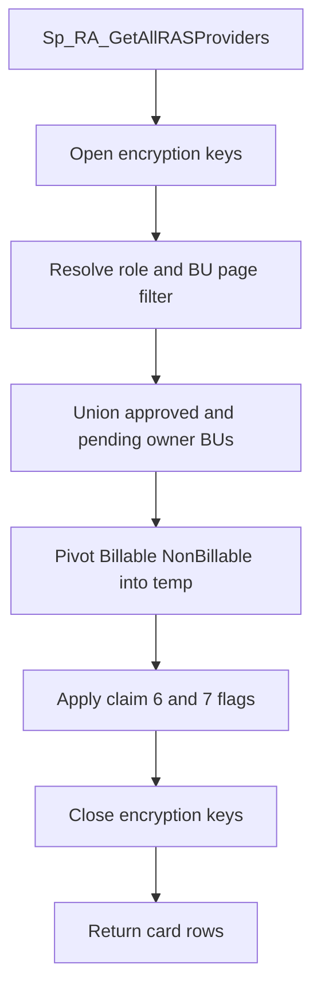

# Sp_RA_GetAllRASProviders

## What it does

Builds the Manage Access RAS Provider card dataset for one or more employers: owner identity, BU location, billable / non-billable allocation totals, approval flags, and View / Edit / Confirm permissions, plus claim-based `RASEditPermission` / `RASConfirmPermission` (claims 6 and 7).

## Parameters

| Name | Direction | What it is for |
|---|---|---|
| `@pEmployeeId` | in | Logged-in employee; used for page-mapping BU filter and prime-owner branch |
| `@pEmployerId` | in | Comma-separated employer ids to include |
| `@pViewType` | in | Declared; not referenced in the body |

## Call sequence

## Callers

No other procedure or function in `HRMS-RESOURCEALLOCATION` calls this object. Application caller: RA WebAPI `raProviderDAL.GetResourceAllocationDetails` from [Manage Access](/docs/guides/resource-allocation/manage-access).

## Nested

| Object | Kind | When | Page |
|---|---|---|---|
| `Sp_OpenEncryptionKeys` | procedure | always (RA synonym → HRMS) | [Sp_OpenEncryptionKeys](/docs/database/hrms/Sp_OpenEncryptionKeys) |
| `Fn_GetEmployeeName` | function | per owner name | [Fn_GetEmployeeName](/docs/database/hrms/Fn_GetEmployeeName) |
| `SP_CloseEncryptionKey` | procedure | always (RA synonym → HRMS) | [SP_CloseEncryptionKey](/docs/database/hrms/SP_CloseEncryptionKey) |

## Steps

1. Script is `HRMS-DATABASE/HRMS-RESOURCEALLOCATION/STOREPROCEDURE/Sp_RA_GetAllRASProviders.sql`.
2. Open encryption keys.
3. Resolve the caller’s role, employer, optional global employer list, and business-unit page-mapping filter from `TUsers` / `TUserEmployee` / `TUSerPagesMapping` / `TRolePagesMapping`.
4. CTE `tblBU` unions approved `TRESOURCE_ALLOC_OWNER_BUSUNIT` rows (`IsApproved = 1`) with pending `TRESOURCE_ALLOC_OWNER_BUSUNIT_REQUEST` rows (`IsApproved = 0`), joined to owners, optional live `TRESOURCEALLOCATION` rows, and `TEmployerDetails` for `CustomerId`, filtered by employer list and optional BU mapping.
5. Pivot allocation percent into Billable / NonBillable into `#tblBUResult`, resolve BU names from `TOrgHierarchyDetails`, and name/email/title from employee synonyms.
6. Outer-apply claim assignments 6 and 7 for edit/confirm capability flags; return ordered by `IsApproved` then `EditedOn`.
7. Close encryption keys.

## Tables

| Table | Read or write |
|---|---|
| `dbo.TUsers` | read (synonym) |
| `dbo.TUserEmployee` | read (synonym) |
| `dbo.TUSerPagesMapping` | read (synonym) |
| `dbo.TRolePagesMapping` | read (synonym) |
| `dbo.TRESOURCE_ALLOCATION_OWNER` | read |
| `dbo.TRESOURCE_ALLOC_OWNER_BUSUNIT` | read |
| `dbo.TRESOURCE_ALLOC_OWNER_BUSUNIT_REQUEST` | read |
| `dbo.TRESOURCEALLOCATION` | read |
| `dbo.TEmployerDetails` | read (synonym) |
| `dbo.TOrgHierarchyDetails` | read (synonym) |
| `dbo.TEmployeeInfo` | read (synonym) |
| `dbo.TEmployee` | read (synonym) |
| `dbo.TTitle` | read (synonym) |
| `dbo.TORGChart` | read (synonym) |
| `dbo.TCLAIM_ASSIGNMENT` | read |

## Unresolved calls

None.

## Flow

