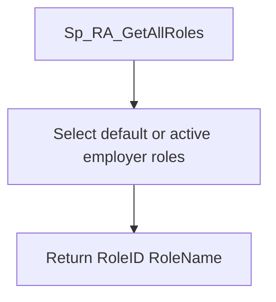

# Sp_RA_GetAllRoles

## What it does

Returns active roles for one employer plus every default role (`IsDefault = 1`). Used to fill the Role dropdown on RA Permission Setup → Setup Permission.

## Parameters

| Name | Direction | What it is for |
|---|---|---|
| `@pEmployerId` | in | Employer whose active roles are included |

## Call sequence

Calls no other procedures or functions.

## Callers

No other procedure or function in `HRMS-RESOURCEALLOCATION` calls this object. Application caller: RA WebAPI `EmployeeDAL.GetAllRoles` → `employeeController.GetAllRoles` from [RA Permission Setup](/docs/guides/admin-configuration/ra-permission-setup).

## Nested

Calls no other procedures or functions.

## Steps

1. Script is `HRMS-DATABASE/HRMS-RESOURCEALLOCATION/STOREPROCEDURE/Sp_RA_GetAllRoles.sql`.
2. Select `RoleID` and `RoleName` from synonym `TRoles` where `IsDefault = 1` or (`IsActive = 'Y'` and `Employerid = @pEmployerId`).

## Tables

| Table | Read or write |
|---|---|
| `dbo.TRoles` | read (via RA synonym to HRMS) |

## Unresolved calls

None.

## Flow

