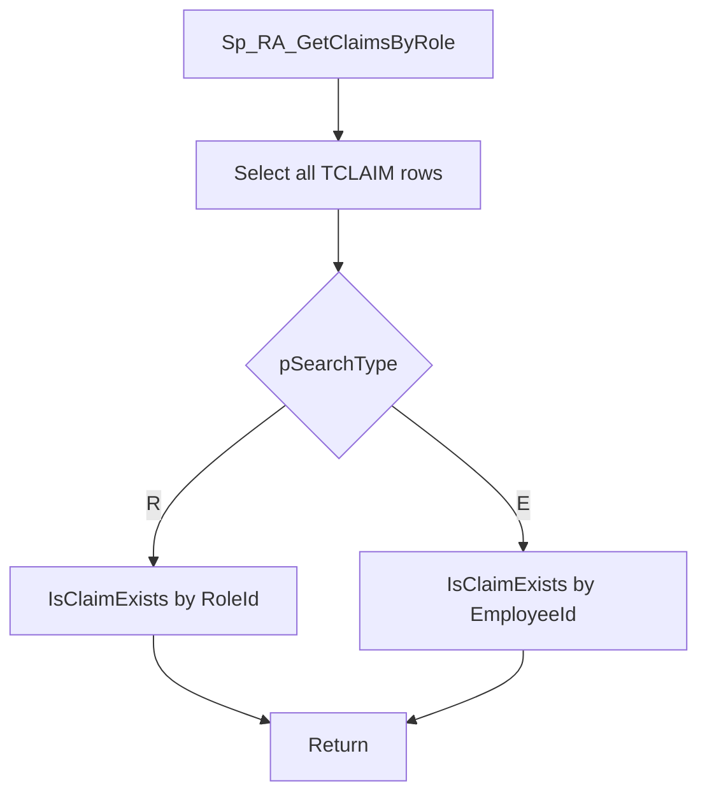

# Sp_RA_GetClaimsByRole

## What it does

Returns every Resource Allocation permission claim from `TCLAIM` with an `IsClaimExists` bit from `TCLAIM_ASSIGNMENT`. When `@pSearchType` is `R`, existence is keyed by role. When it is `E`, existence is keyed by employee. RA Permission Setup uses this for both Role and Employee checkbox loads via `GetClaimsBySearchType`.

## Parameters

| Name | Direction | What it is for |
|---|---|---|
| `@pRoleId` | in | Role id when `@pSearchType` is `R`. Default null |
| `@pEmployerId` | in | Employer on `TCLAIM_ASSIGNMENT.Employerid` |
| `@pSearchType` | in | `R` for role mode, `E` for employee mode |
| `@pEmployeeId` | in | Employee id when `@pSearchType` is `E`. Default null |

## Call sequence

Calls no other procedures or functions.

## Callers

No other procedure or function in `HRMS-RESOURCEALLOCATION` calls this object. Application callers: `EmployeeDAL.GetClaimsBySearchType` and `GetClaimsByRole` → `employeeController` from [RA Permission Setup](/docs/guides/admin-configuration/ra-permission-setup).

## Nested

Calls no other procedures or functions.

## Steps

1. Script is `HRMS-DATABASE/HRMS-RESOURCEALLOCATION/STOREPROCEDURE/Sp_RA_GetClaimsByRole.sql`.
2. Select every `TCLAIM` row (`ClaimID`, `ClaimText`, `ClaimText_Short` as `ClaimShortText`, `ModuleID`).
3. Set `IsClaimExists` true when a matching `TCLAIM_ASSIGNMENT` row exists for that claim, employer, and either `RoleId = @pRoleId` (`R`) or `EmployeeId = @pEmployeeId` (`E`).

## Tables

| Table | Read or write |
|---|---|
| `TCLAIM` | read |
| `TCLAIM_ASSIGNMENT` | read |

## Unresolved calls

None.

## Flow

