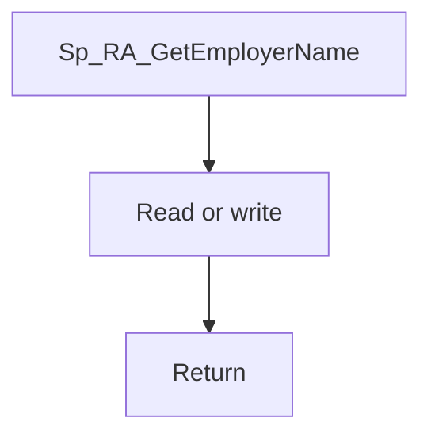

# Sp_RA_GetEmployerName

## What it does

Returns `EmployerName` from `TEmployerDetails` for one employer where not deleted.

## Parameters

| Name | Direction | What it is for |
|---|---|---|
| `@pEmployerId` | in | Employer id |

## Call sequence

Calls no other procedures or functions.

## Callers

Application caller: raDAL.GetEmployerName from [Manage Allocation](/docs/guides/resource-allocation/manage-allocation).

## Nested

Calls no other procedures or functions.

## Steps

1. Script is `HRMS-DATABASE/HRMS-RESOURCEALLOCATION/STOREPROCEDURE/Sp_RA_GetEmployerName.sql`.
2. Returns `EmployerName` from `TEmployerDetails` for one employer where not deleted.

## Tables

| Table | Read or write |
|---|---|
| `dbo.TEmployerDetails` | read (synonym) |

## Unresolved calls

None.

## Flow

