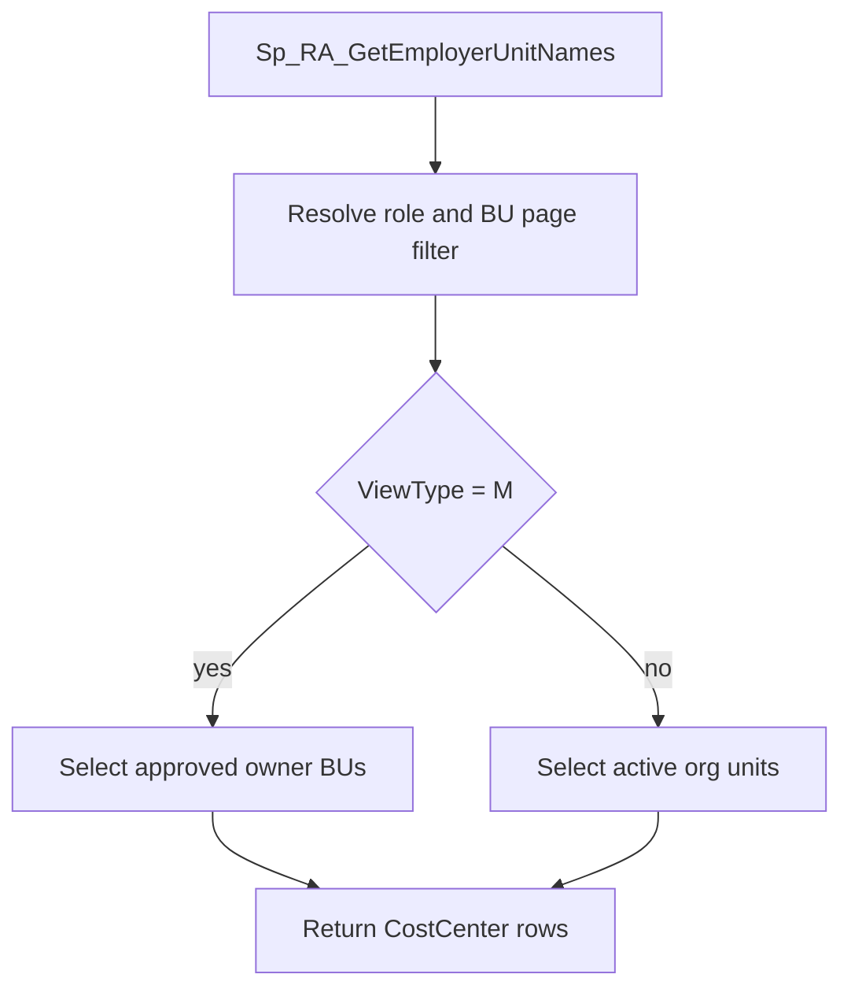

# Sp_RA_GetEmployerUnitNames

## What it does

Returns active organisation-hierarchy units (cost centers / BUs) for the Manage Access business-unit picker. When `@pViewType = 'M'`, limits results to BUs already assigned to the employee as an approved RAS Provider; otherwise returns active units under the employer list, still respecting optional page-mapping BU filters from the user’s role / user page mapping.

## Parameters

| Name | Direction | What it is for |
|---|---|---|
| `@pEmployerid` | in | Comma-separated employer ids |
| `@pEmployeeId` | in | Employee used for role / page-mapping / owner filter |
| `@pViewType` | in | `'M'` = only that employee’s approved owner BUs; otherwise broader org units |

## Call sequence

Calls no other procedures or functions.

## Callers

No other procedure or function in `HRMS-RESOURCEALLOCATION` calls this object. Application caller: RA WebAPI `employeeDAL.ViewCostCenterDetails` from [Manage Access](/docs/guides/resource-allocation/manage-access) `BusinessUnitSearch`.

## Nested

Calls no other procedures or functions.

## Steps

1. Script is `HRMS-DATABASE/HRMS-RESOURCEALLOCATION/STOREPROCEDURE/Sp_RA_GetEmployerUnitNames.sql`.
2. Resolve role, employer, global employer list, and combined `BusinessUnitIds` from `TUsers` / `TUserEmployee` / `TUSerPagesMapping` / `TRolePagesMapping`.
3. If `@pViewType = 'M'`, select active `TOrgHierarchyDetails` joined to approved, non-deleted owner BU rows for `@pEmployeeId`, filtered by employer list and optional BU mapping.
4. Else select active units for the employer list whose parents exist in the hierarchy, with the same optional BU mapping filter.

## Tables

| Table | Read or write |
|---|---|
| `dbo.TUsers` | read (synonym) |
| `dbo.TUserEmployee` | read (synonym) |
| `dbo.TUSerPagesMapping` | read (synonym) |
| `dbo.TRolePagesMapping` | read (synonym) |
| `dbo.TOrgHierarchyDetails` | read (synonym) |
| `dbo.TRESOURCE_ALLOC_OWNER_BUSUNIT` | read |
| `dbo.TRESOURCE_ALLOCATION_OWNER` | read |

## Unresolved calls

None.

## Flow

