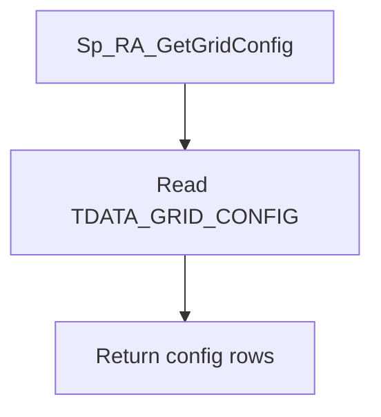

# Sp_RA_GetGridConfig

## What it does

Reads saved grid preference rows for one employee and grid id from `TDATA_GRID_CONFIG` (`ConfigType` values such as `selectableColumnsConfig` and `GridFormat`). Used by RAS Reports for `resourceAllocationReport_Grid`.

## Parameters

| Name | Direction | What it is for |
|---|---|---|
| `@pEmployeeId` | in | Employee who owns the config |
| `@pGridId` | in | Grid key (for example `resourceAllocationReport_Grid`) |

## Call sequence

Calls no other procedures or functions.

## Callers

No other procedure or function in `HRMS-RESOURCEALLOCATION` calls this object. Application caller: `commonDAL.GetGridConfig` → `commonController.GetGridConfig` from [Reports](/docs/guides/resource-allocation/reports).

## Nested

Calls no other procedures or functions.

## Steps

1. Script is `HRMS-DATABASE/HRMS-RESOURCEALLOCATION/STOREPROCEDURE/Sp_RA_GetGridConfig.sql`.
2. `SELECT ConfigId, EmployeeId, GridId, ConfigType, Config` from `TDATA_GRID_CONFIG` where employee and grid match.

## Tables

| Table | Read or write |
|---|---|
| `dbo.TDATA_GRID_CONFIG` | read |

## Unresolved calls

None.

## Flow

