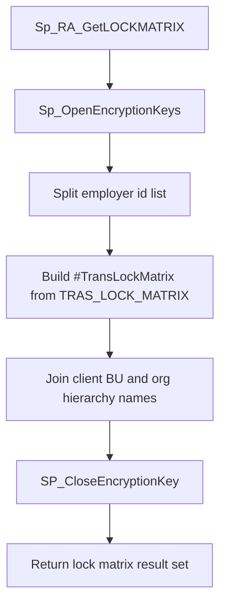

# Sp_RA_GetLOCKMATRIX

## What it does

Returns active lock-policy (lock matrix) rows for one or more employers, optionally filtered by client or project. Joins client and project names (via synonyms), invoice-frequency lookup text, and business-unit names through client–BU mapping. Used by Resource Allocation → Lock Policy to fill **List of Lock Policy**.

## Parameters

| Name | Direction | What it is for |
|---|---|---|
| `@EmployerID` | in | Comma-separated employer ids (`STRING_SPLIT`) |
| `@ClientID` | in | Optional client filter; `NULL` = all clients |
| `@ProjectID` | in | Optional project filter; `NULL` = all projects. V1 DAL does not pass this parameter |

## Call sequence

1. `Sp_OpenEncryptionKeys` (ResourceAllocation synonym → HRMS)
2. Select into `#TransLockMatrix` from `TRAS_LOCK_MATRIX` with `TClient` / `TProject` / `TLOOKUP`
3. Final select joining `TClientBusinessUnitMapping` and `TOrgHierarchyDetails`
4. `SP_CloseEncryptionKey` (ResourceAllocation synonym → HRMS)

## Callers

No other procedure or function in `HRMS-RESOURCEALLOCATION` calls this object. Application caller: RA WebAPI `raDAL.GetLockMatrix` → `raController.GetLockMatrix` from [Lock Policy](/docs/guides/resource-allocation/lock-policy).

## Nested

| Object | Kind | Page |
|---|---|---|
| `Sp_OpenEncryptionKeys` | procedure (synonym) | [Sp_OpenEncryptionKeys](/docs/database/hrms/Sp_OpenEncryptionKeys) |
| `SP_CloseEncryptionKey` | procedure (synonym) | [SP_CloseEncryptionKey](/docs/database/hrms/SP_CloseEncryptionKey) |

## Steps

1. Script is `HRMS-DATABASE/HRMS-RESOURCEALLOCATION/STOREPROCEDURE/Sp_RA_GetLOCKMATRIX.sql`.
2. `SET TRANSACTION ISOLATION LEVEL READ UNCOMMITTED`; open encryption keys.
3. Split `@EmployerID` into `@EmployerIDs`; build `#TransLockMatrix` from `TRAS_LOCK_MATRIX` filtered by employer (and optional client/project), with `TClient.ClientName`, `TProject.ProjectName`, and invoice frequency text from `TLOOKUP` parent `19000`.
4. Return distinct rows with `TOrgHierarchyDetails.UnitName` via `TClientBusinessUnitMapping`.
5. Close encryption key.

## Tables

| Table | Read or write |
|---|---|
| `dbo.TRAS_LOCK_MATRIX` | read |
| `dbo.TClient` | read (synonym) |
| `dbo.TProject` | read (synonym) |
| `dbo.TLOOKUP` | read |
| `dbo.TClientBusinessUnitMapping` | read (synonym) |
| `dbo.TOrgHierarchyDetails` | read (synonym / RA object) |

## Unresolved calls

None at one nested level.

## Flow

