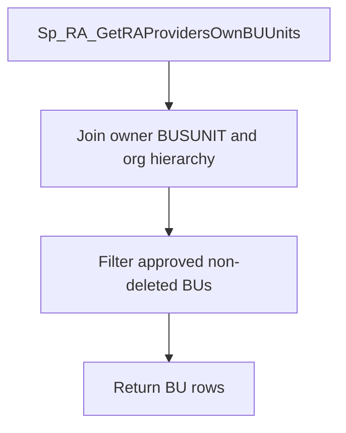

# Sp_RA_GetRAProvidersOwnBUUnits

## What it does

Returns the approved, non-deleted business units already assigned to a RAS Provider for the logged-in employer, filtered to the selected employer id list. Used when Manage Access selects an employee who is already an owner so the UI can prefill BUs.

## Parameters

| Name | Direction | What it is for |
|---|---|---|
| `@pEmployeeId` | in | RAS Provider employee id |
| `@pEmployerid` | in | Comma-separated BU employer ids to include |
| `@pLoggedInEmployerId` | in | Owner row employer id (`TRA.EMPLOYERID`) |

## Call sequence

Calls no other procedures or functions.

## Callers

No other procedure or function in `HRMS-RESOURCEALLOCATION` calls this object. Application caller: RA WebAPI `employeeDAL.GetEmployeeBusUnits` from [Manage Access](/docs/guides/resource-allocation/manage-access).

## Nested

Calls no other procedures or functions.

## Steps

1. Script is `HRMS-DATABASE/HRMS-RESOURCEALLOCATION/STOREPROCEDURE/Sp_RA_GetRAProvidersOwnBUUnits.sql`.
2. Select distinct approved owner BUs joined to `TOrgHierarchyDetails` for names and parent unit name, where the owner is not deleted, is approved, and `BU_EMPLOYERID` is in the split `@pEmployerid` list.

## Tables

| Table | Read or write |
|---|---|
| `dbo.TRESOURCE_ALLOCATION_OWNER` | read |
| `dbo.TRESOURCE_ALLOC_OWNER_BUSUNIT` | read |
| `dbo.TOrgHierarchyDetails` | read (synonym) |

## Unresolved calls

None.

## Flow

