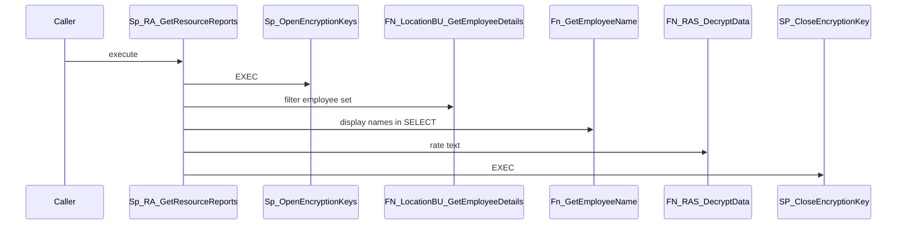
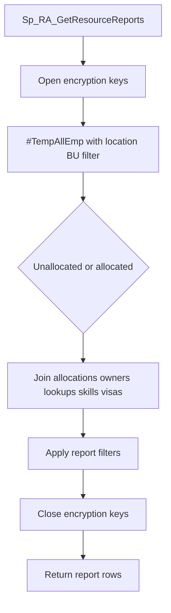

# Sp_RA_GetResourceReports

## What it does

Builds the Resource Allocation **Reports** grid for a comma-separated employer list and optional filters (allocation type, business units, project, dates, capability rating, invoice approver, archive, reallocation flag, unallocated-only, skills, experience bands, visa type/expiry). Opens encryption keys, scopes employees with `FN_LocationBU_GetEmployeeDetails`, optionally restricts to a manager’s team, then returns allocated and/or unallocated resource rows with names, rates, skills, and visas.

## Parameters

| Name | Direction | What it is for |
|---|---|---|
| `@pEmployeeId` | in | Logged-in employee (location/BU scope and manager view) |
| `@pEmployerId` | in | Comma-separated employer ids |
| `@pViewType` | in | `A` all / `M` manager team; blank becomes `A` |
| `@pAllocationType` | in | Optional allocation-type filter |
| `@pBusinessUnitId` | in | Optional comma-separated BU ids |
| `@pProjectName` | in | Optional project id |
| `@pAllocationStartDate` / `@pAllocationEndDate` | in | Optional allocation date window |
| `@pCapabilityRating` | in | Optional capability lookup id |
| `@pInvoiceApprover` | in | Optional invoice approver text |
| `@pIncludeArchive` | in | Include inactive/archive allocations |
| `@pReAllocationCriteria` | in | Available-for-reallocation flag filter |
| `@pUnallocatedResource` | in | When set, unallocated-resource path (`0` treated as null) |
| `@pSkillID` / `@pIsAllSelected` / skill and company/total experience mins/maxes | in | Skill filters |
| `@pVisaTypeID` / `@pVisaExpiryFromDt` / `@pVisaExpiryToDt` | in | Visa filters |

## Call sequence

Also calls `MASTER.dbo.xp_regread` for the server time-zone key (system).

## Callers

No other procedure or function in `HRMS-RESOURCEALLOCATION` calls this object. Application caller: `raReportsDAL.GetReportResults` → `raReportsController.GetReportResults` from [Reports](/docs/guides/resource-allocation/reports).

## Nested

| Object | Kind | When | Page |
|---|---|---|---|
| `Sp_OpenEncryptionKeys` | procedure | start of body | [Sp_OpenEncryptionKeys](/docs/database/hrms/Sp_OpenEncryptionKeys) |
| `FN_LocationBU_GetEmployeeDetails` | function | employee scope join / manager cleanup | [FN_LocationBU_GetEmployeeDetails](/docs/database/hrms/FN_LocationBU_GetEmployeeDetails) |
| `Fn_GetEmployeeName` | function | employee, manager, modifier names | [Fn_GetEmployeeName](/docs/database/hrms/Fn_GetEmployeeName) |
| `FN_RAS_DecryptData` | function | allocation rate columns | [FN_RAS_DecryptData](/docs/database/hrms-resourceallocation/FN_RAS_DecryptData) |
| `SP_CloseEncryptionKey` | procedure | end of body | [SP_CloseEncryptionKey](/docs/database/hrms/SP_CloseEncryptionKey) |

`xp_regread` is a system extended procedure and has no Backstage database page.

## Steps

1. Script is `HRMS-DATABASE/HRMS-RESOURCEALLOCATION/STOREPROCEDURE/Sp_RA_GetResourceReports.sql`.
2. Open encryption keys; read OS time-zone name.
3. Split `@pEmployerId` into `#Employer`; load `#TempAllEmp` with names via `Fn_GetEmployeeName`, filtered by `FN_LocationBU_GetEmployeeDetails`.
4. Normalize `@pViewType` / `@pUnallocatedResource`; optionally build `#ManagersTeam` for view `M`.
5. Branch on unallocated vs allocated paths; join `TRESOURCEALLOCATION`, owners/BUs, clients/projects, lookups, skills, visas.
6. Apply filter predicates; decrypt rates with `FN_RAS_DecryptData`.
7. Close encryption keys; return the report recordset.

## Tables

| Table | Read or write |
|---|---|
| `dbo.TEmployee` | read (synonym) |
| `dbo.TEmployeeInfo` | read (synonym) |
| `dbo.TORGChart` | read (synonym) |
| `dbo.TRESOURCEALLOCATION` | read |
| `dbo.TRESOURCE_ALLOCATION_OWNER` | read |
| `dbo.TRESOURCE_ALLOC_OWNER_BUSUNIT` | read |
| `dbo.TLOOKUP` / client / project / location / title synonyms | read |
| skill / visa detail sources used in SELECT | read |
| `#Employer`, `#TempAllEmp`, `#ManagersTeam`, `#Resources`, other temps | write (temp) |

## Unresolved calls

None at one nested level beyond system `xp_regread`.

## Flow

