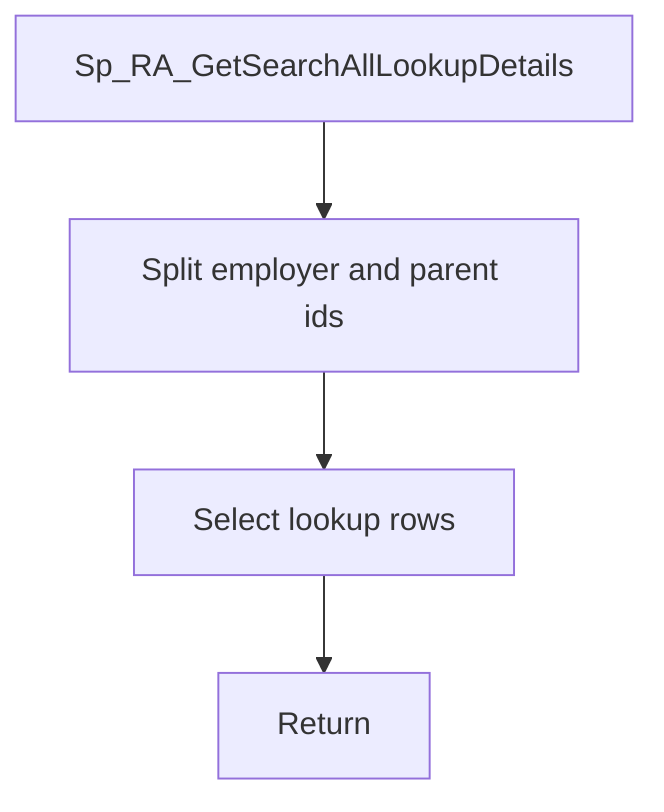

# Sp_RA_GetSearchAllLookupDetails

## What it does

Returns search-filter lookup values (clients, projects, titles, and other parent ids) for one or more employers.

## Parameters

| Name | Direction | What it is for |
|---|---|---|
| `@pEmployerId` | in | Comma-separated employers |
| `@pLookup_Parent_Id` | in | Comma-separated lookup parent ids |

## Call sequence

Calls no other procedures or functions.

## Callers

Application caller: `raDAL` getSearchAllLookupDetails from [Manage Allocation](/docs/guides/resource-allocation/manage-allocation).

## Nested

Calls no other procedures or functions.

## Steps

1. Split employer and parent-id lists into temp tables.
2. Select matching `TLOOKUP`, `TClient`, and `TProject` rows.

## Tables

| Table | Read or write |
|---|---|
| `dbo.TLOOKUP` | read |
| `dbo.TClient` | read |
| `dbo.TProject` | read |
| `dbo.TClientProjectMapping` | read |

## Unresolved calls

None.

## Flow

