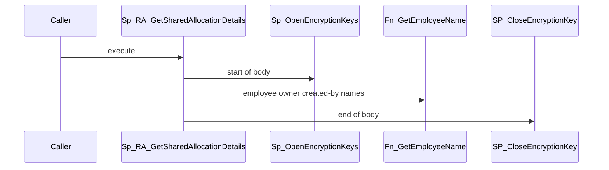
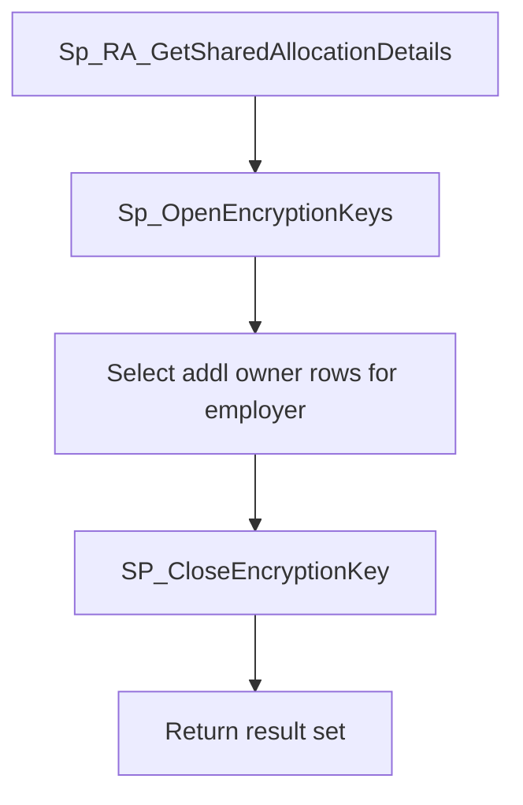

# Sp_RA_GetSharedAllocationDetails

## What it does

Returns non-deleted additional-owner share rows for one employer from `TRESOURCE_ALLOC_ADDL_OWNER`, with employee, owner, and creator display names via `Fn_GetEmployeeName`, ordered by `CreatedOn` descending. Used by the Shared Allocation list grid.

## Parameters

| Name | Direction | What it is for |
|---|---|---|
| `@pEmployerId` | in | Employer whose share rows are returned |

## Call sequence

## Callers

No other procedure or function in HRMS-RESOURCEALLOCATION calls this object. Application callers: Shared Allocation guide (Node `raProviderDAL_V3.GetSharedAllocationDetails`).

## Nested

| Object | Kind | When | Page |
|---|---|---|---|
| `Sp_OpenEncryptionKeys` | procedure (synonym → HRMS) | start of body | [Sp_OpenEncryptionKeys](/docs/database/hrms/Sp_OpenEncryptionKeys) |
| `Fn_GetEmployeeName` | function (synonym → HRMS) | each selected row name | [Fn_GetEmployeeName](/docs/database/hrms/Fn_GetEmployeeName) |
| `SP_CloseEncryptionKey` | procedure (synonym → HRMS) | end of body | [SP_CloseEncryptionKey](/docs/database/hrms/SP_CloseEncryptionKey) |

## Steps

1. `EXEC dbo.Sp_OpenEncryptionKeys` (`Sp_RA_GetSharedAllocationDetails.sql`).
2. Select from `TRESOURCE_ALLOC_ADDL_OWNER` where `isDeleted` is null or 0 and `Employerid = @pEmployerId`.
3. Project ids, allocation percent, comments, created date, and names via `Fn_GetEmployeeName` for employee, addl owner, and created-by.
4. Order by `CreatedOn` desc.
5. `EXEC dbo.SP_CloseEncryptionKey`.

## Tables

| Table | Read or write |
|---|---|
| `TRESOURCE_ALLOC_ADDL_OWNER` | read |

## Flow

