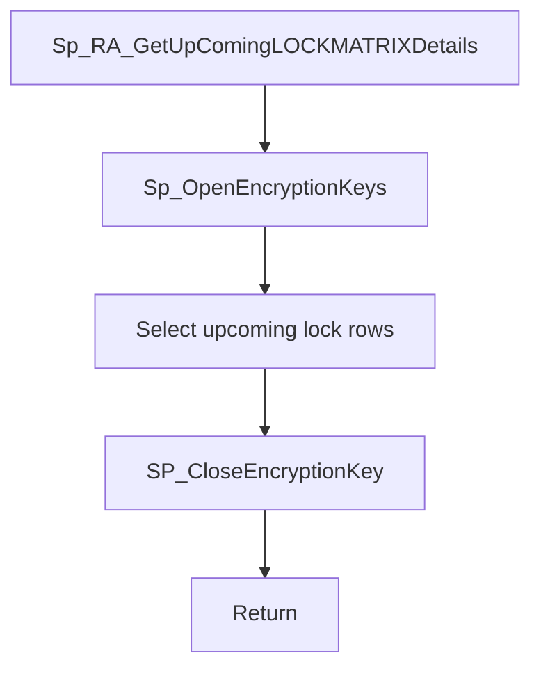

# Sp_RA_GetUpComingLOCKMATRIXDetails

## What it does

Returns upcoming lock-matrix windows for the owner's business units (client/project lock periods used before edit/confirm).

## Parameters

| Name | Direction | What it is for |
|---|---|---|
| `@EmployerID` | in | Employer |
| `@EmployeeID` | in | Owner employee |

## Call sequence

`EXEC Sp_OpenEncryptionKeys` then query; `EXEC SP_CloseEncryptionKey` at end. DAL name is `Sp_RA_GetUpcomingLockMatrixDetails`.

## Callers

Application caller: `raDAL.GetUpcomingLockMatrixDetails` from [Manage Allocation](/docs/guides/resource-allocation/manage-allocation).

## Nested

`Sp_OpenEncryptionKeys`, `SP_CloseEncryptionKey` (HRMS).

## Steps

1. Open encryption keys.
2. Resolve owner BU list from allocation-owner tables.
3. Select upcoming rows from `TRAS_LOCK_MATRIX` with client/project joins.
4. Close encryption keys.

## Tables

| Table | Read or write |
|---|---|
| `dbo.TRAS_LOCK_MATRIX` | read |
| `dbo.TRESOURCE_ALLOCATION_OWNER` | read |
| `dbo.TRESOURCE_ALLOC_OWNER_BUSUNIT` | read |
| `dbo.TClient / TProject / TClientBusinessUnitMapping` | read |

## Unresolved calls

None.

## Flow

