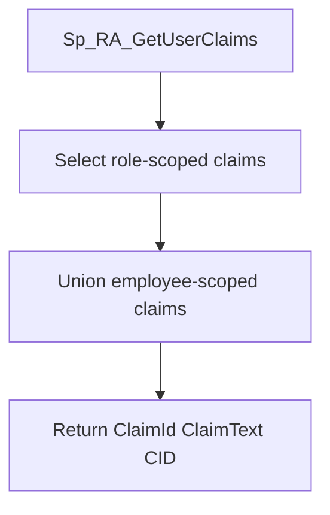

# Sp_RA_GetUserClaims

## What it does

Returns the effective Resource Allocation claim catalog for a signed-in user by unioning assignments for their role and for their employee id within one employer.

## Parameters

| Name | Direction | What it is for |
|---|---|---|
| `@pRoleId` | in | User role id |
| `@pEmployerid` | in | Employer scope |
| `@pEmployeeId` | in | Employee id for employee-scoped assignments |

## Call sequence

Calls no other procedures or functions.

## Callers

No other procedure or function in `HRMS-RESOURCEALLOCATION` calls this object. Application caller: RA WebAPI `employeeDAL.GetRASClaims` from Resource Allocation `setupUser.js` (including [Manage Access](/docs/guides/resource-allocation/manage-access)).

## Nested

Calls no other procedures or functions.

## Steps

1. Script is `HRMS-DATABASE/HRMS-RESOURCEALLOCATION/STOREPROCEDURE/Sp_RA_GetUserClaims.sql`.
2. Select claim id/text from `TCLAIM_ASSIGNMENT` joined to `TCLAIM` where `RoleId = @pRoleId` and employer matches.
3. Union the same shape for `EmployeeId = @pEmployeeId` and employer matches.

## Tables

| Table | Read or write |
|---|---|
| `dbo.TCLAIM_ASSIGNMENT` | read |
| `dbo.TCLAIM` | read |

## Unresolved calls

None.

## Flow

