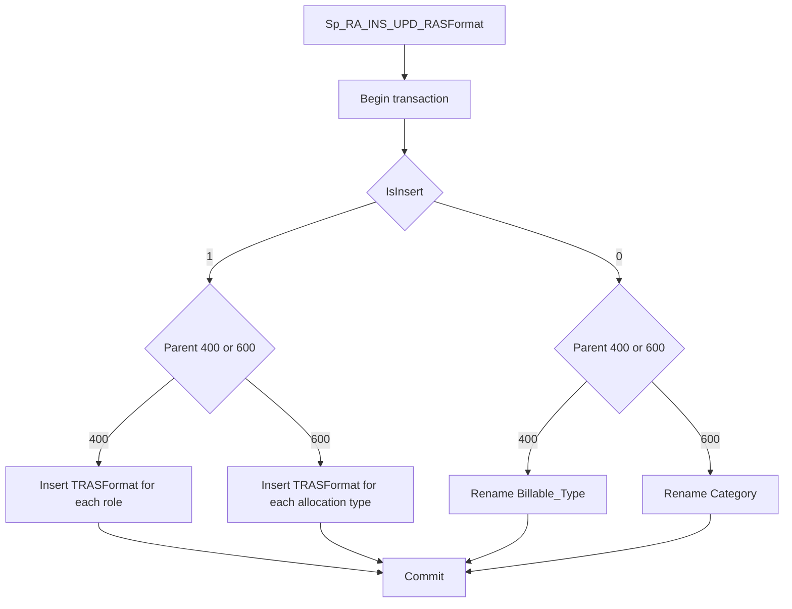

# Sp_RA_INS_UPD_RASFormat

## What it does

Keeps `TRASFormat` aligned when an allocation type (`LookupParentId = 400`) or role (`600`) lookup text is inserted or renamed. On insert it cross-products the new value against the other dimension for Offshore and Onsite. On update it renames matching `Billable_Type` or `Category` text.

## Parameters

| Name | Direction | What it is for |
|---|---|---|
| `@LookupText` | in | New text |
| `@OldLookupText` | in | Previous text when updating |
| `@LookupParentId` | in | `400` allocation type or `600` role |
| `@IsInsert` | in | `1` insert path, `0` update path |

## Call sequence

Calls no other procedures or functions.

## Callers

Procedures and functions that call this object.

| Object | Kind | Page |
|---|---|---|
| `Sp_RA_InsertUpdate_TLookup` | procedure | [Sp_RA_InsertUpdate_TLookup](/docs/database/hrms-resourceallocation/Sp_RA_InsertUpdate_TLookup) |

## Nested

Calls no other procedures or functions.

## Steps

1. Script is `HRMS-DATABASE/HRMS-RESOURCEALLOCATION/STOREPROCEDURE/Sp_RA_INS_UPD_RASFormat.sql`.
2. Begin a transaction.
3. If `@IsInsert = 1` and parent `400`, and `Billable_Type` does not already exist, cursor over role texts (`Lookup_Parent_Id = 600`) and insert Offshore/Onsite `TRASFormat` rows for each.
4. If `@IsInsert = 1` and parent `600`, and `Category` does not already exist, cursor over allocation types (`Lookup_Parent_Id = 400`) and insert Offshore/Onsite rows.
5. If `@IsInsert = 0`, update `Billable_Type` or `Category` from `@OldLookupText` to `@LookupText`.
6. Commit, or rollback and rethrow on error.

## Tables

| Table | Read or write |
|---|---|
| `dbo.TRASFormat` | read and write |
| `dbo.TLOOKUP` | read |

## Flow

