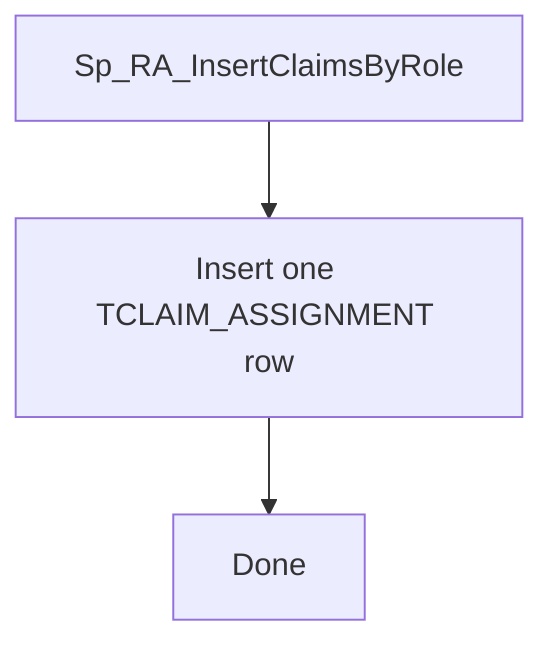

# Sp_RA_InsertClaimsByRole

## What it does

Inserts one `TCLAIM_ASSIGNMENT` row for a claim granted to a role or employee under an employer. RA Permission Setup calls this once per checked claim after `Sp_RA_DeleteClaimsByRole` inside the BLL transaction.

## Parameters

| Name | Direction | What it is for |
|---|---|---|
| `@pClaimId` | in | Claim to assign |
| `@pRoleID` | in | Role id for role grants. Default null |
| `@pEmployerId` | in | Employer on the assignment |
| `@pSearchType` | in | Passed by the app; not used inside the insert body |
| `@pEmployeeId` | in | Employee id for employee grants. Default null |

## Call sequence

Calls no other procedures or functions.

## Callers

No other procedure or function in `HRMS-RESOURCEALLOCATION` calls this object. Application caller: `EmployeeDAL.InsertClaimsBySearchType` → `employeeBLL.InsertClaimsBySearchType` from [RA Permission Setup](/docs/guides/admin-configuration/ra-permission-setup).

## Nested

Calls no other procedures or functions.

## Steps

1. Script is `HRMS-DATABASE/HRMS-RESOURCEALLOCATION/STOREPROCEDURE/Sp_RA_InsertClaimsByRole.sql`.
2. Insert into `TCLAIM_ASSIGNMENT` (`ClaimID`, `RoleId`, `Employerid`, `EmployeeId`) the supplied parameter values.
3. `@pSearchType` is accepted but not referenced in the insert statement.

## Tables

| Table | Read or write |
|---|---|
| `TCLAIM_ASSIGNMENT` | write (insert) |

## Unresolved calls

None.

## Flow

