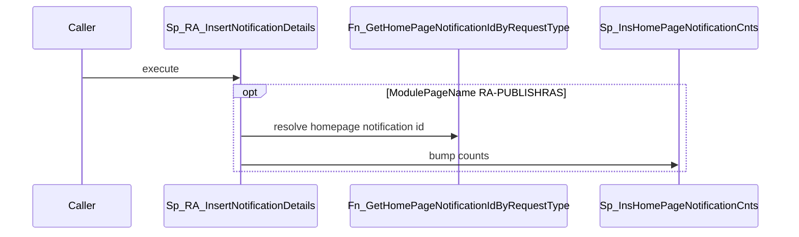
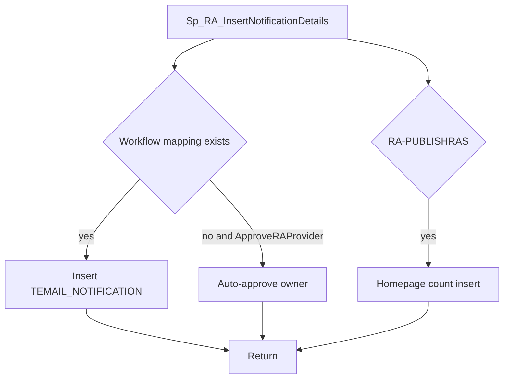

# Sp_RA_InsertNotificationDetails

## What it does

Queues a `TEMAIL_NOTIFICATION` row when the module page has an active workflow mapping. For Manage Access (`RA-ApproveRAProvider`), if no workflow mapping exists it auto-sets `TRESOURCE_ALLOCATION_OWNER.IsApproved = 1` instead. A separate `RA-PUBLISHRAS` branch bumps homepage notification counts.

## Parameters

| Name | Direction | What it is for |
|---|---|---|
| `@RequestId` | in | Request / employee id used as notification request id |
| `@BUId` | in | Business unit id on the notification row |
| `@NoOfDays` | in | Days field (default 0) |
| `@ModulePageName` | in | Module page key (Manage Access uses `RA-ApproveRAProvider`) |
| `@NotificationType` | in | Notification type string |
| `@Level` | in | Workflow level (default 1) |
| `@RequestRaisedBy` | in | Employee the request is for (API maps `RequestRaisedFor`) |
| `@UpdatedBy` | in | Actor employee id |
| `@EmployerId` | in | Employer id |
| `@Comments` | in | Comments |
| `@Content` | in | Extra content |

## Call sequence

## Callers

No other procedure or function in `HRMS-RESOURCEALLOCATION` calls this object. Application caller: RA WebAPI `notificationDAL.InsertNotificationDetails` (also first step of approve/reject notification controllers) from [Manage Access](/docs/guides/resource-allocation/manage-access).

## Nested

| Object | Kind | When | Page |
|---|---|---|---|
| `Fn_GetHomePageNotificationIdByRequestType` | function | when module is `RA-PUBLISHRAS` (RA synonym → HRMS) | [Fn_GetHomePageNotificationIdByRequestType](/docs/database/hrms/Fn_GetHomePageNotificationIdByRequestType) |
| `Sp_InsHomePageNotificationCnts` | procedure | when module is `RA-PUBLISHRAS` (RA synonym → HRMS) | [Sp_InsHomePageNotificationCnts](/docs/database/hrms/Sp_InsHomePageNotificationCnts) |

## Steps

1. Script is `HRMS-DATABASE/HRMS-RESOURCEALLOCATION/STOREPROCEDURE/Sp_RA_InsertNotificationDetails.sql`.
2. For `RA-ApproveRAProvider`, count non-deleted workflow mappings on `TWorkflowManagement` / `TModulePages`.
3. If count ≠ 0, insert into `TEMAIL_NOTIFICATION`.
4. Else if module is `RA-ApproveRAProvider` and count is 0, update `TRESOURCE_ALLOCATION_OWNER.IsApproved = 1` for `@RequestRaisedBy`.
5. If module is `RA-PUBLISHRAS`, resolve homepage notification id and call `Sp_InsHomePageNotificationCnts`.

## Tables

| Table | Read or write |
|---|---|
| `dbo.TWorkflowManagement` | read (synonym / shared) |
| `dbo.TModulePages` | read (synonym / shared) |
| `dbo.TEMAIL_NOTIFICATION` | write |
| `dbo.TRESOURCE_ALLOCATION_OWNER` | write |

## Unresolved calls

None.

## Flow

