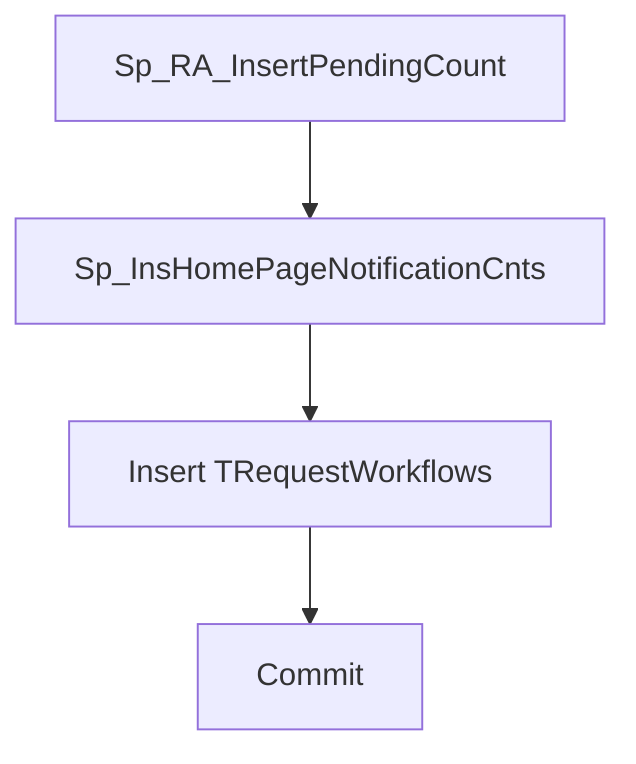

# Sp_RA_InsertPendingCount

## What it does

Raises homepage pending counts and seeds `TRequestWorkflows` for a new RA unlock/freeze workflow request.

## Parameters

| Name | Direction | What it is for |
|---|---|---|
| `@RequestId` | in | Unlock/request id |
| `@RequestCreatedBy` | in | Requester employee |
| `@Employerid` | in | Employer |
| `@RequestType` | in | Notification/request type |
| `@workflowId` | in | Workflow id |

## Call sequence

`Fn_GetHomePageNotificationIdByRequestType` then `Sp_InsHomePageNotificationCnts`; inserts `TRequestWorkflows`.

## Callers

Nested from `SP_RA_InsUdt_TRAS_UNLOCK_REQUEST` used by [Manage Allocation](/docs/guides/resource-allocation/manage-allocation).

## Nested

`Fn_GetHomePageNotificationIdByRequestType`, `Sp_InsHomePageNotificationCnts`.

## Steps

1. Resolve homepage notification id by request type.
2. Increment pending counts for requester/approvers.
3. Insert workflow manager rows.

## Tables

| Table | Read or write |
|---|---|
| `dbo.TRequestWorkflows` | write |
| `dbo.TEmployeeInfo / TOrgChart` | read (synonym) |

## Unresolved calls

None.

## Flow

