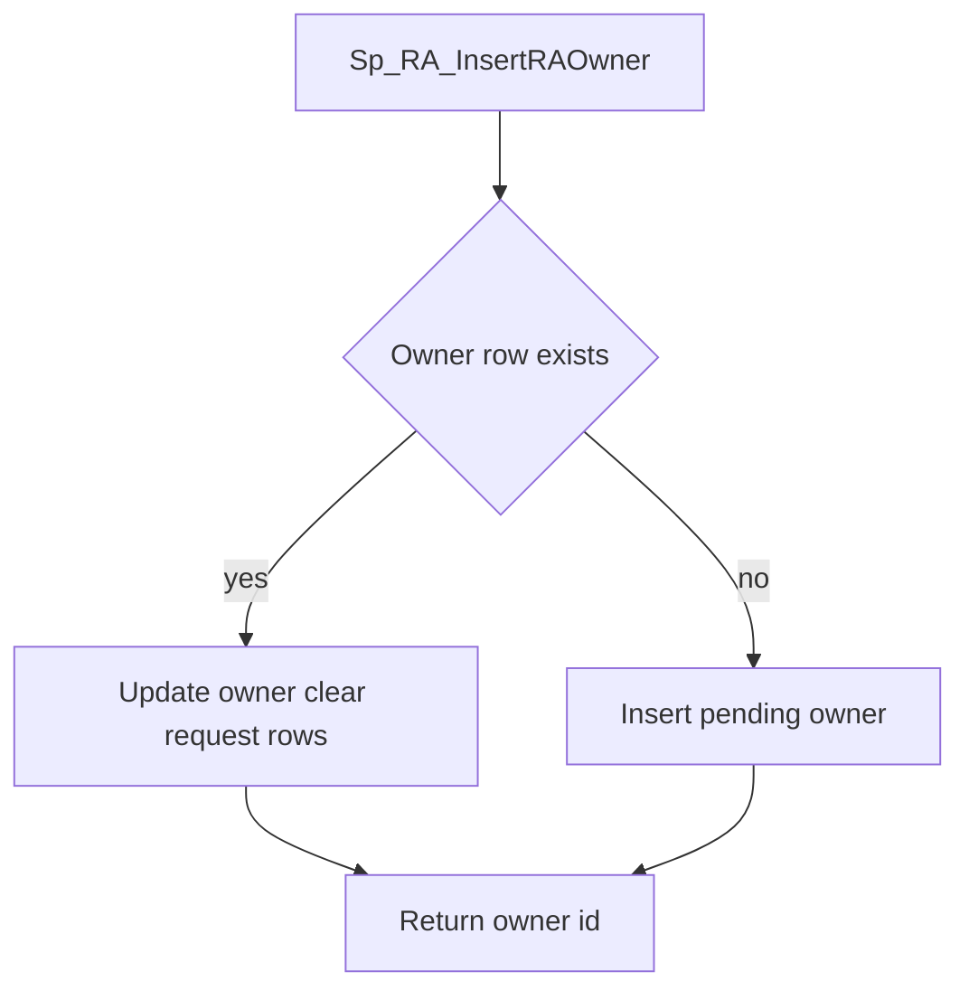

# Sp_RA_InsertRAOwner

## What it does

Creates or reactivates a RAS Provider owner row for one employee and employer, returns `@pResAllocOwnerID`, clears pending BU request rows when the owner already exists, and sets `IsApproved` based on whether approved BU mappings already exist.

## Parameters

| Name | Direction | What it is for |
|---|---|---|
| `@pEmployeeID` | in | Employee becoming RAS Provider |
| `@pEmployerid` | in | Employer of the owner row |
| `@pIsDeleted` | in | Deleted flag on insert |
| `@pIsApproved` | in | Approval flag; may be forced to 1 when approved BUs already exist |
| `@pBusUnitIds` | in | Comma-separated BU ids (accepted; not used in the body) |
| `@pCreatedBy` | in | Creator employee id |
| `@pEditedBy` | in | Editor employee id |
| `@pResAllocOwnerID` | out | Owner primary key |

## Call sequence

Calls no other procedures or functions.

## Callers

No other procedure or function in `HRMS-RESOURCEALLOCATION` calls this object. Application caller: RA WebAPI `raProviderDAL.InsertResourceAllocationOwner` via `raProviderBLL.InsertResourceAllocationOwner` from [Manage Access](/docs/guides/resource-allocation/manage-access).

## Nested

Calls no other procedures or functions.

## Steps

1. Script is `HRMS-DATABASE/HRMS-RESOURCEALLOCATION/STOREPROCEDURE/Sp_RA_InsertRAOwner.sql`.
2. If a row exists in `TRESOURCE_ALLOCATION_OWNER` for the employee and employer, capture `ResourceAllocationOwnerID`, set `@pIsApproved = 1` when any non-deleted `TRESOURCE_ALLOC_OWNER_BUSUNIT` rows exist, update the owner (`IsApproved`, `IsDeleted = 0`, edit audit), and delete all `TRESOURCE_ALLOC_OWNER_BUSUNIT_REQUEST` rows for that owner.
3. Otherwise insert a new owner with `IsApproved = 0` and set `@pResAllocOwnerID` from `SCOPE_IDENTITY()`.

## Tables

| Table | Read or write |
|---|---|
| `dbo.TRESOURCE_ALLOCATION_OWNER` | read / write |
| `dbo.TRESOURCE_ALLOC_OWNER_BUSUNIT` | read |
| `dbo.TRESOURCE_ALLOC_OWNER_BUSUNIT_REQUEST` | write (delete) |

## Unresolved calls

None.

## Flow

