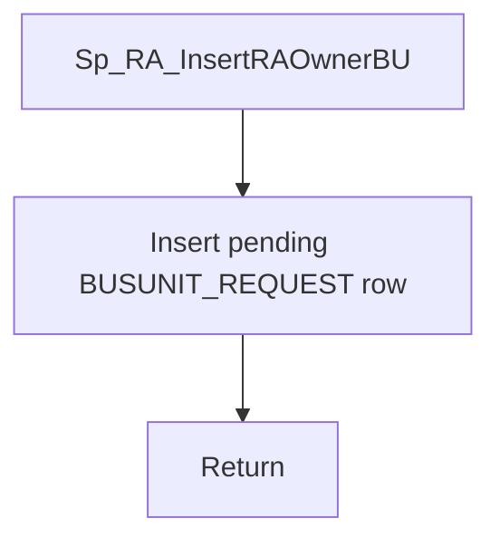

# Sp_RA_InsertRAOwnerBU

## What it does

Inserts one pending RAS Provider business-unit assignment into `TRESOURCE_ALLOC_OWNER_BUSUNIT_REQUEST` for an owner id. Sets `IS_PRIME_OWNER` to 1 only when `@pBusinessUnitId = 65`, otherwise 0 (ignores `@pIsPrimeOwner` for the stored value).

## Parameters

| Name | Direction | What it is for |
|---|---|---|
| `@pResAllocOwnerID` | in | Owner id from `Sp_RA_InsertRAOwner` |
| `@pEmployerId` | in | Stored as `BU_EMPLOYERID` |
| `@pBusinessUnitId` | in | Business unit id |
| `@pIsPrimeOwner` | in | Passed from API; not used for the inserted `IS_PRIME_OWNER` value |
| `@pCreatedBy` | in | Creator employee id |

## Call sequence

Calls no other procedures or functions.

## Callers

No other procedure or function in `HRMS-RESOURCEALLOCATION` calls this object. Application caller: RA WebAPI `raProviderDAL.InsertResourceAllocationOwnerBU` inside the insert-owner BLL transaction from [Manage Access](/docs/guides/resource-allocation/manage-access).

## Nested

Calls no other procedures or functions.

## Steps

1. Script is `HRMS-DATABASE/HRMS-RESOURCEALLOCATION/STOREPROCEDURE/Sp_RA_InsertRAOwnerBU.sql`.
2. Insert one row into `TRESOURCE_ALLOC_OWNER_BUSUNIT_REQUEST` with `IS_PRIME_OWNER = CASE WHEN @pBusinessUnitId IN (65) THEN 1 ELSE 0 END`.

## Tables

| Table | Read or write |
|---|---|
| `dbo.TRESOURCE_ALLOC_OWNER_BUSUNIT_REQUEST` | write |

## Unresolved calls

None.

## Flow

