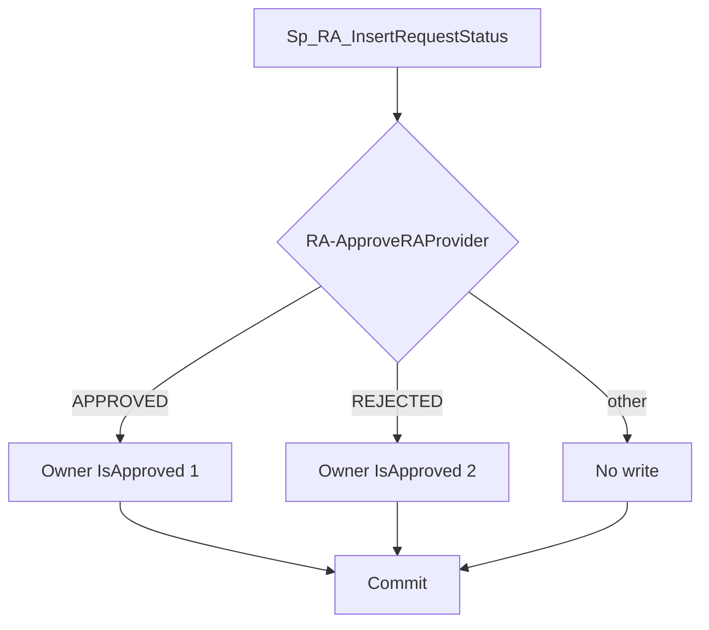

# Sp_RA_InsertRequestStatus

## What it does

Nested status helper used by approval/rejection notification procedures. For `RA-ApproveRAProvider`, updates `TRESOURCE_ALLOCATION_OWNER.IsApproved` to 1 on `APPROVED` or 2 on `REJECTED`, with comments and edit audit. Other request types fall through with no table write in this script.

## Parameters

| Name | Direction | What it is for |
|---|---|---|
| `@pRequestId` | in | Request id (unused in the RA-ApproveRAProvider body beyond the call signature) |
| `@pRequestType` | in | Module page name |
| `@pNotificationType` | in | `APPROVED` or `REJECTED` |
| `@pLevel` | in | Level text (unused in body) |
| `@pEmployeeId` | in | Owner employee id to update |
| `@pEmployerId` | in | Employer id (unused in body) |
| `@pComments` | in | Comments (unused; hard-coded comments written) |
| `@pCreatedBy` | in | Editor employee id |
| `@pSendApprovalEmail` | in | Optional flag (unused in body) |
| `@pStatusId` | in | Optional status id (unused in body) |

## Call sequence

Calls no other procedures or functions.

## Callers

| Object | Kind | Page |
|---|---|---|
| `Sp_RA_UpdatePendingCount` | procedure | [Sp_RA_UpdatePendingCount](/docs/database/hrms-resourceallocation/Sp_RA_UpdatePendingCount) |
| `Sp_RA_UpdateRejectPendingCount` | procedure | [Sp_RA_UpdateRejectPendingCount](/docs/database/hrms-resourceallocation/Sp_RA_UpdateRejectPendingCount) |

## Nested

Calls no other procedures or functions.

## Steps

1. Script is `HRMS-DATABASE/HRMS-RESOURCEALLOCATION/STOREPROCEDURE/Sp_RA_InsertRequestStatus.sql`.
2. Begin transaction.
3. If request type is `RA-ApproveRAProvider` and notification type is `APPROVED`, set owner `IsApproved = 1` with comment `Request Approved.`.
4. If the same request type and `REJECTED`, set owner `IsApproved = 2` with comment `Request Rejected.`.
5. Commit or roll back.

## Tables

| Table | Read or write |
|---|---|
| `dbo.TRESOURCE_ALLOCATION_OWNER` | write |

## Unresolved calls

None.

## Flow

