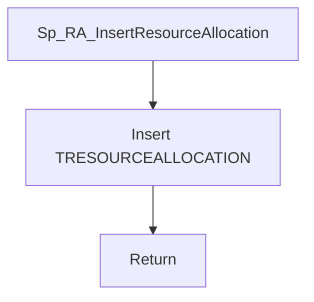

# Sp_RA_InsertResourceAllocation

## What it does

Inserts one active row into `TRESOURCEALLOCATION` for an employee/employer with client, project, BU, dates, percent, rate, and reallocation flags.

## Parameters

| Name | Direction | What it is for |
|---|---|---|
| `@pEmployeeID` | in | Employee being allocated |
| `@pEmployerid` | in | Employer |
| `@pClient_CD` | in | Client id |
| `@pClientLocation_ID` | in | Client location |
| `@pClientResourceMgr` | in | Client resource manager text |
| `@pClientInvoiceApprover` | in | Invoice approver text |
| `@pBusiness_Unit_ID` | in | Business unit |
| `@pProject_CD` | in | Project id |
| `@pProjectType_CD` | in | Project type lookup |
| `@pAllocationType_CD` | in | Allocation type |
| `@pAllocation_Percent` | in | Allocation percent |
| `@pAllocationTitle_CD` | in | Title lookup |
| `@pAllocation_StartDate` | in | Start |
| `@pAllocation_EndDate` | in | End |
| `@pRole_CD` | in | Role lookup |
| `@pResourceLocation_ID` | in | Location |
| `@pCurrency_CD` | in | Currency |
| `@pRate` | in | Rate |
| `@pAvailableForReallocation` | in | Flag |
| `@pCapabilityRating_CD` | in | Capability rating |
| `@pResourceLocationArea_ID` | in | Location area |
| `@pRemarks` | in | Remarks |
| `@pCreatedBy / @pEditedBy` | in | Actor |
| `@pSequenceNo` | in | Sequence (defaults to 1) |
| `@PAvailableForReallocationText` | in | Reallocation text |

## Call sequence

Calls no other procedures or functions.

## Callers

Also nested from `Sp_RA_UpdateResourceAllocation` when creating a new allocation on update. Application caller: `raDAL.InsertResourceAllocationDetails` from [Manage Allocation](/docs/guides/resource-allocation/manage-allocation).

## Nested

Calls no other procedures or functions.

## Steps

1. Default `@pSequenceNo` to 1 when null.
2. Insert into `TRESOURCEALLOCATION` with `IsActive = 1` and audit columns.

## Tables

| Table | Read or write |
|---|---|
| `dbo.TRESOURCEALLOCATION` | write |

## Unresolved calls

None.

## Flow

