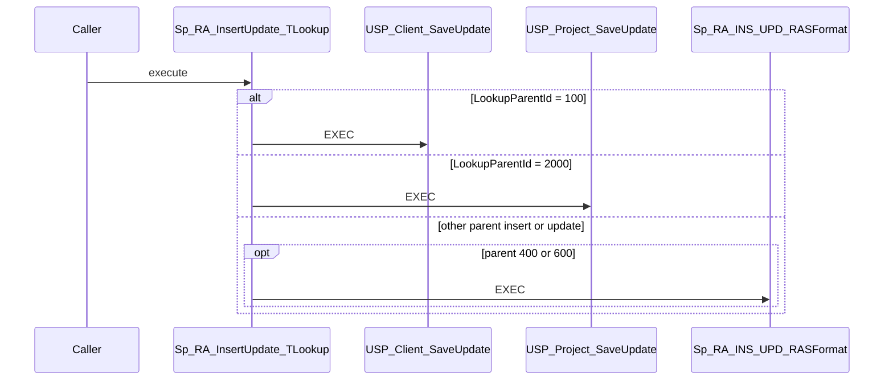
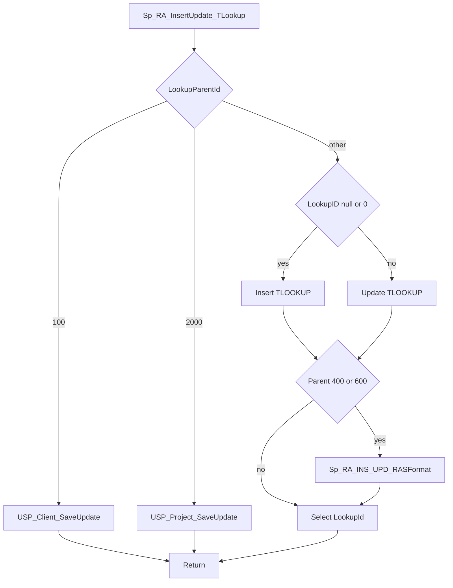

# Sp_RA_InsertUpdate_TLookup

## What it does

Inserts or updates a Resource Allocation reference row. When `@LookupParentId` is `100` (client) or `2000` (project), it delegates to core USP helpers via synonyms. For other parents it writes `TLOOKUP` (synonym to HRMS) and, for allocation type (`400`) or role (`600`), refreshes `TRASFormat`.

## Parameters

| Name | Direction | What it is for |
|---|---|---|
| `@LookupID` | in | Existing lookup id; null/0 means insert |
| `@LookupText` | in | Display text |
| `@LookupParentId` | in | Parent type id (100 client, 2000 project, 400/600 RAS format, others) |
| `@LookupBUs` | in | Comma-separated business unit ids (client path) |
| `@SubParentId` | in | Sub-parent / client id for projects |
| `@pEmployerid` | in | Employer scope |
| `@AdditionalInfo` | in | Extra text |
| `@CreatedBy` | in | Acting employee id |

## Call sequence

## Callers

No other procedure or function in `HRMS-RESOURCEALLOCATION` calls this object. Application caller: RA WebAPI `SaveLookupData`.

## Nested

| Object | Kind | When | Page |
|---|---|---|---|
| `USP_Client_SaveUpdate` | procedure | `@LookupParentId = 100` | [USP_Client_SaveUpdate](/docs/database/hrms/USP_Client_SaveUpdate) |
| `USP_Project_SaveUpdate` | procedure | `@LookupParentId = 2000` | [USP_Project_SaveUpdate](/docs/database/hrms/USP_Project_SaveUpdate) |
| `Sp_RA_INS_UPD_RASFormat` | procedure | parent 400 or 600 on insert/update of other branch | [Sp_RA_INS_UPD_RASFormat](/docs/database/hrms-resourceallocation/Sp_RA_INS_UPD_RASFormat) |

## Steps

1. Script is `HRMS-DATABASE/HRMS-RESOURCEALLOCATION/STOREPROCEDURE/Sp_RA_InsertUpdate_TLookup.sql`.
2. If `@LookupParentId = 100`, `EXEC dbo.USP_Client_SaveUpdate` with the same parameters and return.
3. Else if `@LookupParentId = 2000`, `EXEC dbo.USP_Project_SaveUpdate` with the same parameters and return.
4. Else if `@LookupID` is null/0, compute `MAX(Lookup_Id)+1`, insert into `TLOOKUP`, and when parent is 400 or 600 call `Sp_RA_INS_UPD_RASFormat` with `@IsInsert = 1`.
5. Else update `TLOOKUP` for the employer, and when parent is 400 or 600 call `Sp_RA_INS_UPD_RASFormat` with `@IsInsert = 0`.
6. Select `@NewLookupId AS LookupId`.

## Tables

| Table | Read or write |
|---|---|
| `dbo.TLOOKUP` | read and write (via RA synonym to HRMS) |
| `dbo.TRASFormat` | write via nested `Sp_RA_INS_UPD_RASFormat` |
| `dbo.TClient` | write via nested `USP_Client_SaveUpdate` |
| `dbo.TProject` | write via nested `USP_Project_SaveUpdate` |

## Flow

