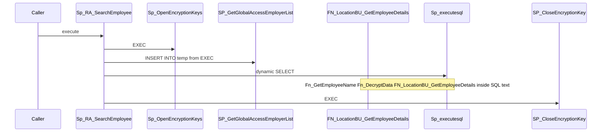
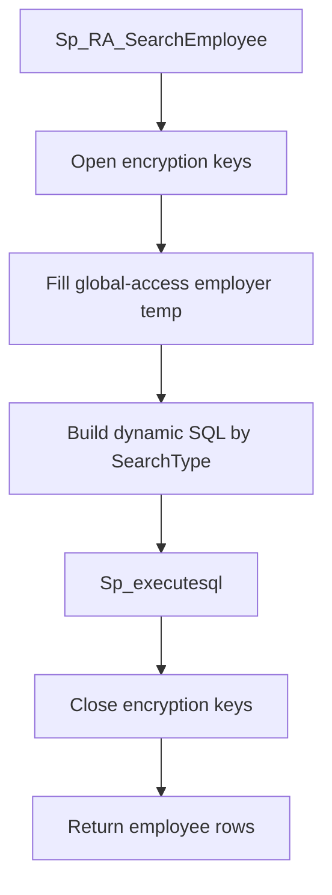

# Sp_RA_SearchEmployee

## What it does

Searches active employees visible to the caller’s global-access employer list, optionally filtered by self (`E`), manager tree (`M`), or all (`A` / blank). Builds dynamic SQL that decrypts names and DOB. Used by the Employee picker on RA Permission Setup → Setup Permission.

## Parameters

| Name | Direction | What it is for |
|---|---|---|
| `@pEmployeeId` | in | Logged-in / filter employee id. Default null |
| `@pEmployerid` | in | Declared as varchar list; not used in the dynamic SELECT body |
| `@pEmployeeName` | in | Optional name fragment for `LIKE` filter. Default null |
| `@SearchType` | in | `A` all, `E` self, `M` manager reports; blank becomes `A` |
| `@CountryId` | in | Accepted; defaulted to `-1` when null; not referenced in the dynamic SQL |

## Call sequence

## Callers

No other procedure or function in `HRMS-RESOURCEALLOCATION` calls this object. Application caller: `EmployeeDAL.GetEmployeeDetails` → `employeeController.GetEmployeeDetails` from [RA Permission Setup](/docs/guides/admin-configuration/ra-permission-setup) employee search.

## Nested

| Object | Kind | When | Page |
|---|---|---|---|
| `Sp_OpenEncryptionKeys` | procedure | start of body | [Sp_OpenEncryptionKeys](/docs/database/hrms/Sp_OpenEncryptionKeys) |
| `SP_GetGlobalAccessEmployerList` | procedure | fill `#tmpEmployer` when temp table missing | [SP_GetGlobalAccessEmployerList](/docs/database/hrms/SP_GetGlobalAccessEmployerList) |
| `Fn_GetEmployeeName` | function | inside dynamic SQL | [Fn_GetEmployeeName](/docs/database/hrms/Fn_GetEmployeeName) |
| `Fn_DecryptData` | function | DOB decrypt in dynamic SQL | [Fn_DecryptData](/docs/database/hrms/Fn_DecryptData) |
| `FN_LocationBU_GetEmployeeDetails` | function | location/BU employee filter join | [FN_LocationBU_GetEmployeeDetails](/docs/database/hrms/FN_LocationBU_GetEmployeeDetails) |
| `SP_CloseEncryptionKey` | procedure | end of body | [SP_CloseEncryptionKey](/docs/database/hrms/SP_CloseEncryptionKey) |

`Sp_executesql` is a system procedure and has no Backstage database page.

## Steps

1. Script is `HRMS-DATABASE/HRMS-RESOURCEALLOCATION/STOREPROCEDURE/Sp_RA_SearchEmployee.sql`.
2. Open encryption keys.
3. If `#tmpEmployer` does not exist, create it and insert results of `SP_GetGlobalAccessEmployerList @pEmployeeId`.
4. Build optional name `LIKE` predicate and search-type predicate (`A` / `E` / `M`).
5. Build and `Sp_executesql` a SELECT over `TEmployee` / `TEmployeeInfo` / `TORGChart` filtered to `#tmpEmployer` and `FN_LocationBU_GetEmployeeDetails`.
6. Close encryption keys.

## Tables

| Table | Read or write |
|---|---|
| `dbo.TEmployee` | read (synonym) |
| `dbo.TEmployeeInfo` | read (synonym) |
| `dbo.TORGChart` | read (synonym) |
| `dbo.TOrgHierarchyDetails` | read (synonym) |
| `dbo.TGender` | read (synonym) |
| `dbo.TTitle` | read (synonym) |
| `dbo.TGrade` | read (synonym) |
| `#tmpEmployer` | write (temp) |

## Unresolved calls

None at one nested level beyond system `Sp_executesql`. Inventory script has no `@IsInitiateReallocation` parameter, but Node `employeeDAL.GetEmployeeDetails` binds that name.

## Flow

