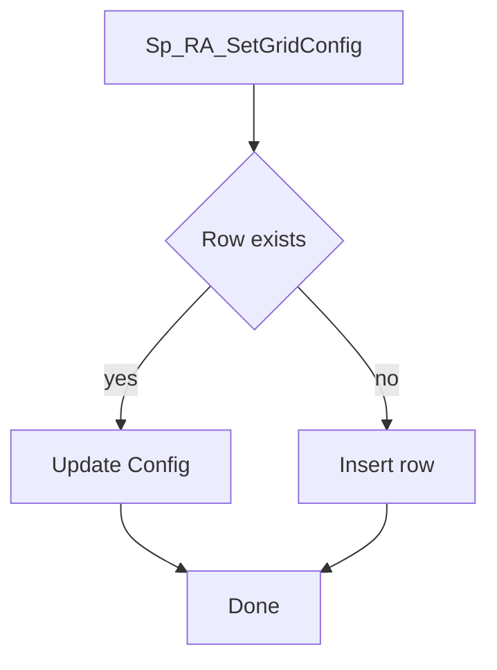

# Sp_RA_SetGridConfig

## What it does

Upserts one grid preference row in `TDATA_GRID_CONFIG` for an employee, grid id, and config type. If a matching row exists, updates `Config`; otherwise inserts.

## Parameters

| Name | Direction | What it is for |
|---|---|---|
| `@pEmployeeId` | in | Employee who owns the config |
| `@pGridId` | in | Grid key |
| `@pConfigType` | in | Preference kind (`selectableColumnsConfig`, `GridFormat`, …) |
| `@pConfig` | in | JSON text payload |

## Call sequence

Calls no other procedures or functions.

## Callers

No other procedure or function in `HRMS-RESOURCEALLOCATION` calls this object. Application caller: `commonDAL.SetGridConfig` → `commonController.SetGridConfig` from [Reports](/docs/guides/resource-allocation/reports).

## Nested

Calls no other procedures or functions.

## Steps

1. Script is `HRMS-DATABASE/HRMS-RESOURCEALLOCATION/STOREPROCEDURE/Sp_RA_SetGridConfig.sql`.
2. If a row exists for employee + grid + config type, `UPDATE Config`.
3. Else `INSERT` a new `TDATA_GRID_CONFIG` row.

## Tables

| Table | Read or write |
|---|---|
| `dbo.TDATA_GRID_CONFIG` | read and write |

## Unresolved calls

None.

## Flow

