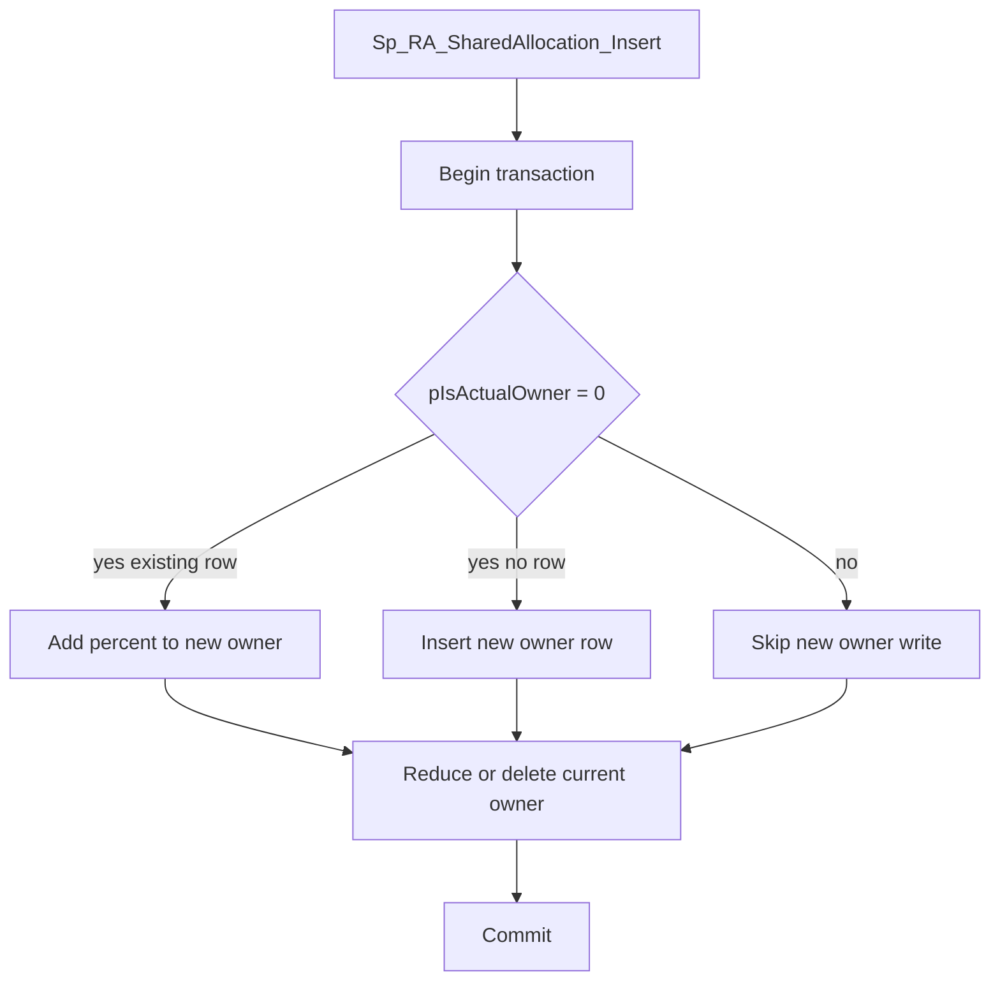

# Sp_RA_SharedAllocation_Insert

## What it does

Moves allocation percent from a current additional-owner (or reporting-manager share context) to a new additional owner for one employee/employer inside a transaction. When `@pIsActualOwner = 0`, inserts or increments the new owner’s `TRESOURCE_ALLOC_ADDL_OWNER` row; always reduces the current owner’s percent and deletes that row if the remainder is not greater than zero.

## Parameters

| Name | Direction | What it is for |
|---|---|---|
| `@pEmployeeID` | in | Employee whose share is being split |
| `@pEmployerId` | in | Employer context |
| `@pNewOwnerId` | in | Manager receiving the percent |
| `@pAllocationPercent` | in | Percent to move |
| `@pComments` | in | Comments on insert of a new row |
| `@pLoggedInUser` | in | Actor for CreatedBy / EditedBy |
| `@pIsActualOwner` | in | When 0, create/update the new-owner row; when 1, skip that block |
| `@pCurrentOwnerId` | in | Owner giving up the percent |

## Call sequence

Calls no other procedures or functions.

## Callers

No other procedure or function in HRMS-RESOURCEALLOCATION calls this object. Application callers: Shared Allocation manage modal (Node `raProviderDAL_V3.InsertEmployeeSharedAllocation`).

## Nested

Calls no other procedures or functions.

## Steps

1. `BEGIN TRAN` / `BEGIN TRY` (`Sp_RA_SharedAllocation_Insert.sql`).
2. If `@pIsActualOwner = 0` and an active row already exists for `@pNewOwnerId`, add `@pAllocationPercent` to `AllocPercentage`.
3. Else if `@pIsActualOwner = 0`, insert a new `TRESOURCE_ALLOC_ADDL_OWNER` row for the new owner.
4. Compute current owner’s new limit as existing percent minus `@pAllocationPercent`.
5. If that remainder is greater than 0, update the current owner’s `AllocPercentage`; else delete the current owner’s active row.
6. `COMMIT TRAN`; on error `ROLLBACK TRAN` (no `THROW`).

## Tables

| Table | Read or write |
|---|---|
| `TRESOURCE_ALLOC_ADDL_OWNER` | read, write |

## Flow

