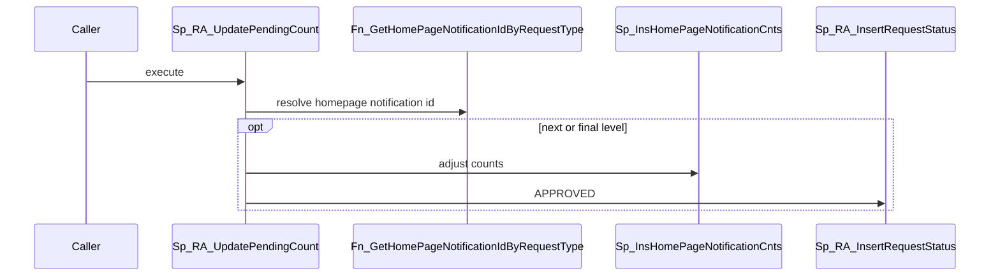
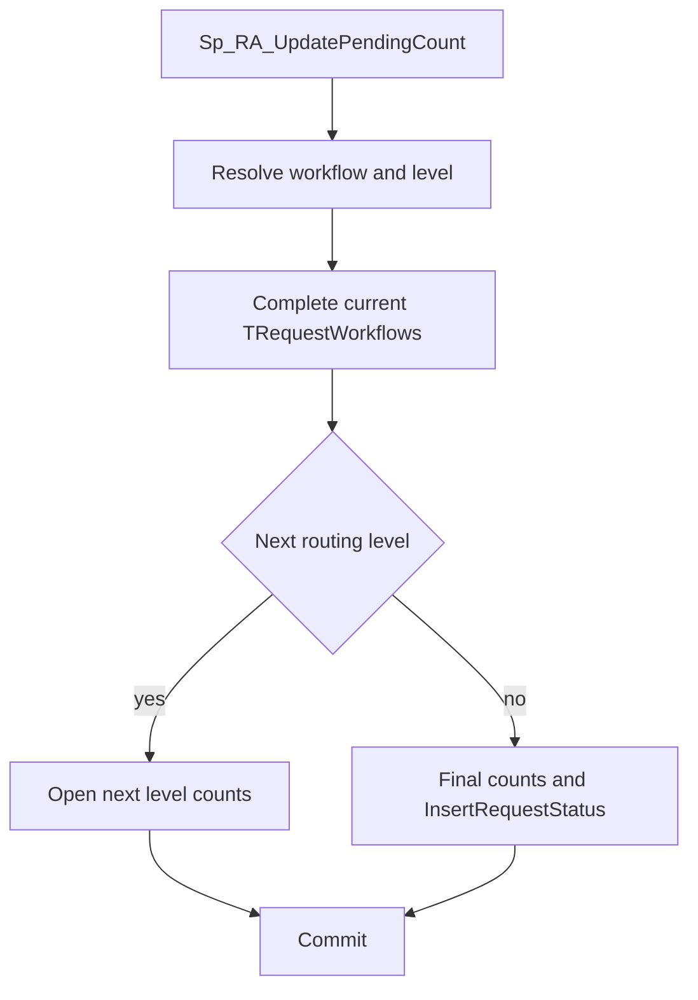

# Sp_RA_UpdatePendingCount

## What it does

Advances an approval workflow after a Manage Access approve notification: marks the current `TRequestWorkflows` level complete, optionally opens the next routing level with homepage counts, and calls `Sp_RA_InsertRequestStatus` with `APPROVED` when the flow completes or needs an approval email.

## Parameters

| Name | Direction | What it is for |
|---|---|---|
| `@RequestId` | in | Request / employee id |
| `@RequestCreatedBy` | in | Employee the request was raised for |
| `@EmployeeId` | in | Approver (logged-in) employee id |
| `@Employerid` | in | Employer id |
| `@RequestType` | in | Module page name (e.g. `RA-ApproveRAProvider`) |
| `@Comments` | in | Approval comments |

## Call sequence

## Callers

No other procedure or function in `HRMS-RESOURCEALLOCATION` calls this object. Application caller: RA WebAPI `notificationDAL.UpdatePendingCount` from [Manage Access](/docs/guides/resource-allocation/manage-access) approve path.

## Nested

| Object | Kind | When | Page |
|---|---|---|---|
| `Fn_GetHomePageNotificationIdByRequestType` | function | always (RA synonym → HRMS) | [Fn_GetHomePageNotificationIdByRequestType](/docs/database/hrms/Fn_GetHomePageNotificationIdByRequestType) |
| `Sp_InsHomePageNotificationCnts` | procedure | next-level / final-level branches (RA synonym → HRMS) | [Sp_InsHomePageNotificationCnts](/docs/database/hrms/Sp_InsHomePageNotificationCnts) |
| `Sp_RA_InsertRequestStatus` | procedure | approval completion branches | [Sp_RA_InsertRequestStatus](/docs/database/hrms-resourceallocation/Sp_RA_InsertRequestStatus) |

## Steps

1. Script is `HRMS-DATABASE/HRMS-RESOURCEALLOCATION/STOREPROCEDURE/Sp_RA_UpdatePendingCount.sql`.
2. Begin transaction; resolve workflow id and routing levels from `TWorkflowManagement` / `TModulePages`.
3. Find the pending approval level for `@EmployeeId` on `TRequestWorkflows`; resolve homepage notification id.
4. Mark the current level (and peer managers at that level) complete.
5. If a next routing level exists, insert next-level workflow rows / homepage counts as coded; otherwise adjust final counts and `EXEC Sp_RA_InsertRequestStatus` with `APPROVED`.
6. Commit or roll back.

## Tables

| Table | Read or write |
|---|---|
| `dbo.TWorkflowManagement` | read |
| `dbo.TModulePages` | read |
| `dbo.TRequestWorkflows` | read / write |
| `dbo.TWorkflowDetails` | read |

## Unresolved calls

None.

## Flow

