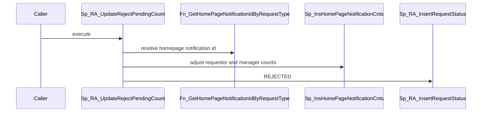
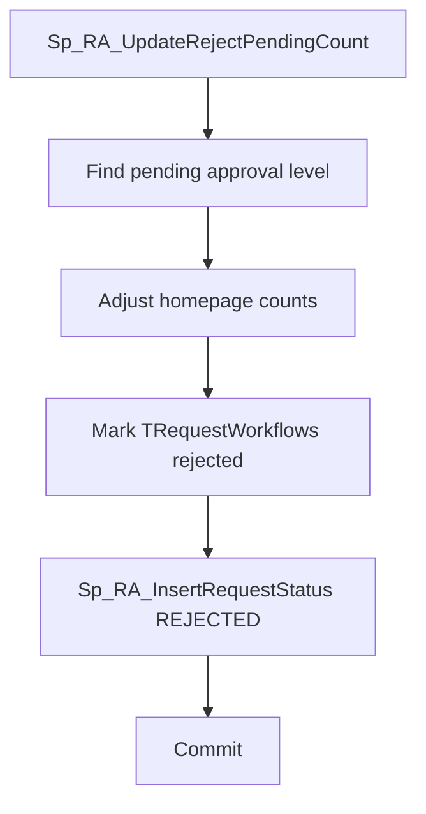

# Sp_RA_UpdateRejectPendingCount

## What it does

Handles the Manage Access reject-notification path: marks the current `TRequestWorkflows` level rejected, adjusts homepage notification counts for the requestor and managers, and calls `Sp_RA_InsertRequestStatus` with `REJECTED`.

## Parameters

| Name | Direction | What it is for |
|---|---|---|
| `@RequestId` | in | Request / employee id |
| `@RequestCreatedBy` | in | Employee the request was raised for |
| `@EmployeeId` | in | Rejecting employee id |
| `@Employerid` | in | Employer id |
| `@RequestType` | in | Module page name (e.g. `RA-ApproveRAProvider`) |
| `@Comments` | in | Rejection comments |

## Call sequence

## Callers

No other procedure or function in `HRMS-RESOURCEALLOCATION` calls this object. Application caller: RA WebAPI `notificationDAL.UpdateRejectPendingCount` from [Manage Access](/docs/guides/resource-allocation/manage-access) reject path.

## Nested

| Object | Kind | When | Page |
|---|---|---|---|
| `Fn_GetHomePageNotificationIdByRequestType` | function | always (RA synonym → HRMS) | [Fn_GetHomePageNotificationIdByRequestType](/docs/database/hrms/Fn_GetHomePageNotificationIdByRequestType) |
| `Sp_InsHomePageNotificationCnts` | procedure | always for requestor and managers (RA synonym → HRMS) | [Sp_InsHomePageNotificationCnts](/docs/database/hrms/Sp_InsHomePageNotificationCnts) |
| `Sp_RA_InsertRequestStatus` | procedure | always | [Sp_RA_InsertRequestStatus](/docs/database/hrms-resourceallocation/Sp_RA_InsertRequestStatus) |

## Steps

1. Script is `HRMS-DATABASE/HRMS-RESOURCEALLOCATION/STOREPROCEDURE/Sp_RA_UpdateRejectPendingCount.sql`.
2. Begin transaction; resolve manager ids from `TEMPLOYEEINFO` / `TORGCHART` and the pending approval level on `TRequestWorkflows`.
3. Resolve homepage notification id; call `Sp_InsHomePageNotificationCnts` for the requestor (decrement) and for managers at the level.
4. Mark current-level workflow rows `ApproveStatus = 'R'`.
5. `EXEC Sp_RA_InsertRequestStatus` with `REJECTED`.
6. Commit or roll back.

## Tables

| Table | Read or write |
|---|---|
| `dbo.TEMPLOYEEINFO` | read (synonym) |
| `dbo.TORGCHART` | read (synonym) |
| `dbo.TRequestWorkflows` | read / write |

## Unresolved calls

None.

## Flow

