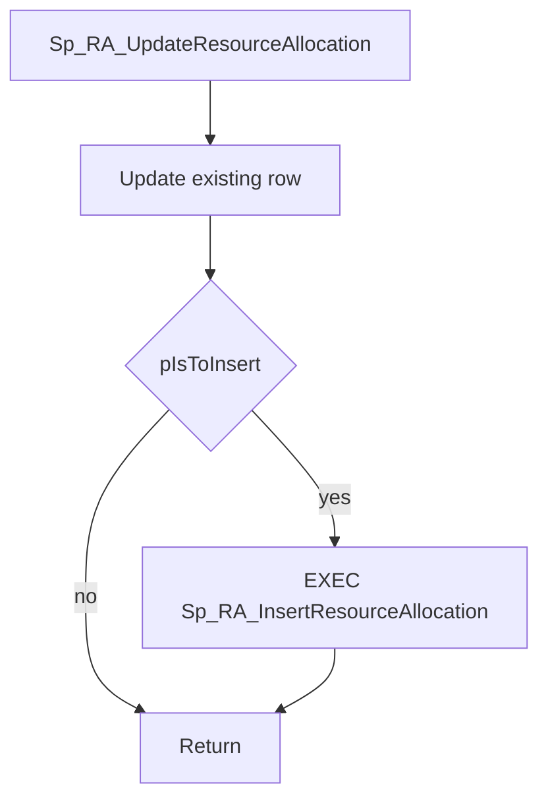

# Sp_RA_UpdateResourceAllocation

## What it does

Updates an existing `TRESOURCEALLOCATION` row (or ends/reallocates). When `@pIsToInsert` requests a new allocation, EXEC `Sp_RA_InsertResourceAllocation` after adjusting the current row.

## Parameters

| Name | Direction | What it is for |
|---|---|---|
| `@pResourceAllocationID` | in | Row to update |
| `@pEmployeeId / @pEmployerId` | in | Employee and employer |
| `@pClient_CD … @pRemarks` | in | Same allocation field set as insert |
| `@pEditedBy` | in | Actor |
| `@pSequenceNo` | in | Sequence |
| `@pIsToInsert` | in | When set, create a follow-on allocation via insert |
| `@IsBulkUpdate` | in | Bulk update path flag |
| `@PAvailableForReallocationText` | in | Reallocation text |

## Call sequence

May `EXEC Sp_RA_InsertResourceAllocation` when creating a new allocation from an update/reallocate path.

## Callers

Application caller: `raDAL.UpdateResourceAllocationDetails` (and bulk update BLL) from [Manage Allocation](/docs/guides/resource-allocation/manage-allocation).

## Nested

`Sp_RA_InsertResourceAllocation`.

## Steps

1. Update the target `TRESOURCEALLOCATION` row with the supplied field set.
2. When `@pIsToInsert` indicates a new allocation is required, EXEC `Sp_RA_InsertResourceAllocation` with the new values.

## Tables

| Table | Read or write |
|---|---|
| `dbo.TRESOURCEALLOCATION` | read/write |

## Unresolved calls

None.

## Flow

