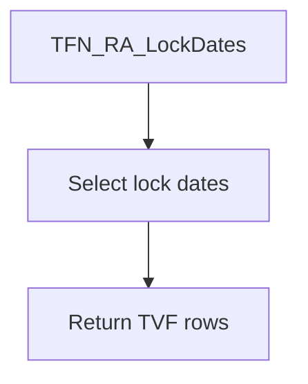

# TFN_RA_LockDates

## What it does

Table-valued helper returning lock date window columns for one allocation/project (outer-applied by `USP_RA_GetResourcesList`).

## Parameters

| Name | Direction | What it is for |
|---|---|---|
| `@ResourceAllocationId` | in | Allocation id |
| `@Project_Cd` | in | Project id |

## Call sequence

Reads lock-matrix related data; no EXEC of procedures.

## Callers

Nested from `USP_RA_GetResourcesList` used by [Manage Allocation](/docs/guides/resource-allocation/manage-allocation).

## Nested

None (function).

## Steps

1. Script is `FUNCTIONS/TFN_RA_LockDates.sql`.
2. Return lock start/end (and related) columns for the allocation.

## Tables

| Table | Read or write |
|---|---|
| `dbo.TRAS_LOCK_MATRIX` | read |

## Unresolved calls

None.

## Flow

