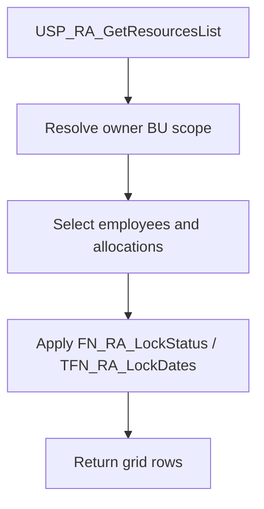

# USP_RA_GetResourcesList

## What it does

Returns the Manage Resources grid for one or more employers: employee rows with current or filtered `TRESOURCEALLOCATION` data, manager names, lock status, unlock requests, and last confirmation. `ViewType` `M` scopes to the caller's owned BUs; `A` is all-resources.

## Parameters

| Name | Direction | What it is for |
|---|---|---|
| `@pEmployerId` | in | Comma-separated employer ids |
| `@pEmployeeId` | in | Logged-in employee (owner / scope) |
| `@ViewType` | in | `M` my resources or `A` all |
| `@Organisation` | in | Optional organisation filter |
| `@Client` | in | Optional client filter |
| `@Project` | in | Optional project filter |
| `@EmployeeName` | in | Optional name filter |
| `@Allocated` | in | Allocated / unallocated / both flag |
| `@AvailableForReAllocation` | in | Optional reallocation flag |
| `@IncludeArchiveAllocations` | in | Optional archive include |
| `@StartDate` | in | Optional allocation start filter |
| `@EndDate` | in | Optional allocation end filter |
| `@AllocationTypeCd` | in | Optional allocation type codes |
| `@BusinessUnitId` | in | Comma-separated BU ids |

## Call sequence

Uses scalar/TVF helpers `FN_RA_LockStatus`, `TFN_RA_LockDates`, `Fn_GetEmployeeName`, and `FN_LocationBU_GetEmployeeDetails`. Does not EXEC other procedures.

## Callers

No other procedure in ResourceAllocation calls this object. Application caller: RA WebAPI `raDAL.GetResourcesList` → `raController.GetResourcesList` from [Manage Allocation](/docs/guides/resource-allocation/manage-allocation).

## Nested

`FN_RA_LockStatus`, `TFN_RA_LockDates` (RA). HRMS helpers via synonym: `Fn_GetEmployeeName`, `FN_LocationBU_GetEmployeeDetails`.

## Steps

1. Script is `HRMS-DATABASE/HRMS-RESOURCEALLOCATION/STOREPROCEDURE/USP_RA_GetResourcesList.sql`.
2. Resolve owner / additional-owner BU scope from `TRESOURCE_ALLOCATION_OWNER` / `TRESOURCE_ALLOC_OWNER_BUSUNIT` when `ViewType = M`.
3. Select employee + allocation rows from synonyms `VW_TEmployee_FullName`, `TEmployeeInfo`, left join `TRESOURCEALLOCATION`, clients/projects, reallocation initiate, unlock requests, confirmation.
4. Compute lock status via `FN_RA_LockStatus` / `TFN_RA_LockDates`.

## Tables

| Table | Read or write |
|---|---|
| `dbo.TRESOURCEALLOCATION` | read |
| `dbo.TRESOURCE_ALLOCATION_OWNER` | read |
| `dbo.TRESOURCE_ALLOC_OWNER_BUSUNIT` | read |
| `dbo.TRESOURCEALLOCATION_CONFIRMATION` | read |
| `dbo.TRAS_UNLOCK_REQUEST` | read |
| `dbo.TReallocationInitiate` | read |
| `dbo.TClient / TProject` | read |
| `dbo.TEmployee / TEmployeeInfo / VW_TEmployee_FullName` | read (synonym) |

## Unresolved calls

None.

## Flow

