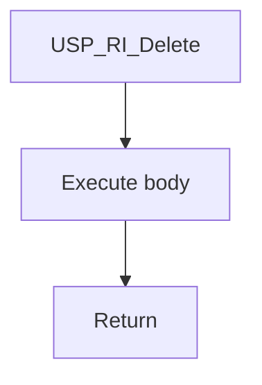

# USP_RI_Delete

## What it does

Soft-deletes a reallocation initiate (`IsDeleted = 1`, status `Deleted`) and inserts a status-history row.

## Parameters

| Name | Direction | What it is for |
|---|---|---|
| `@ReallocationInitiateID` | in | Request id |
| `@EmployeeID / @EmployerID / @UpdatedBy` | in | Actors |

## Call sequence

Calls no other procedures (inline history insert).

## Callers

Application caller: RA WebAPI `raDAL` from [Manage Allocation](/docs/guides/resource-allocation/manage-allocation) Initiate Reallocation / Notifications.

## Nested

Calls no other procedures (inline history insert).

## Steps

1. Script is `HRMS-DATABASE/HRMS-RESOURCEALLOCATION/STOREPROCEDURE/USP_RI_Delete.sql`.
2. Soft-deletes a reallocation initiate (`IsDeleted = 1`, status `Deleted`) and inserts a status-history row.

## Tables

| Table | Read or write |
|---|---|
| `dbo.TReallocationInitiate` | write |
| `dbo.TReallocationInitiateStatusHistory` | write |

## Unresolved calls

None.

## Flow

